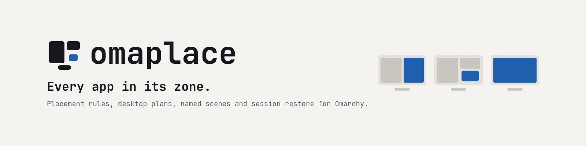
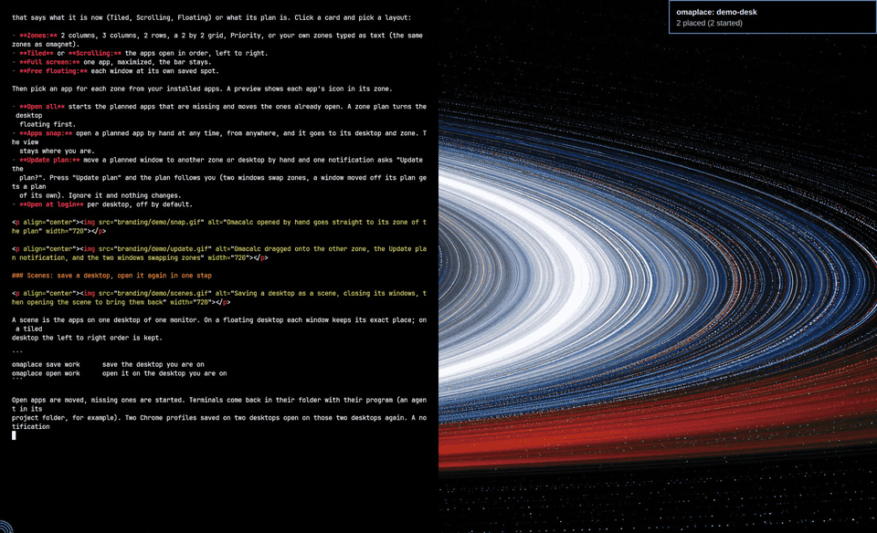
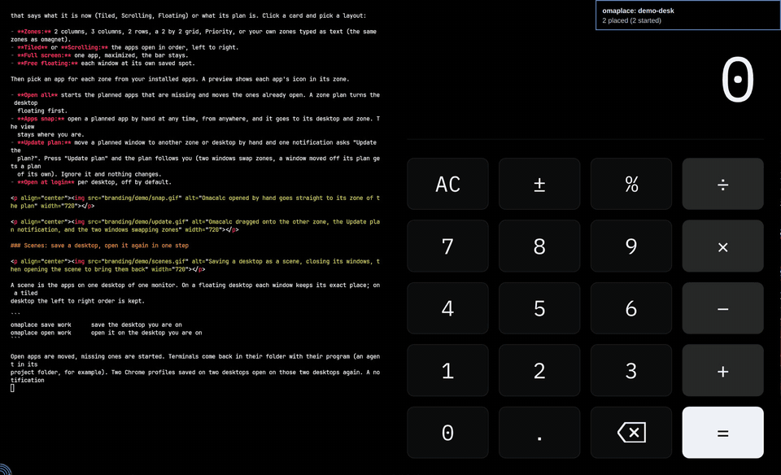
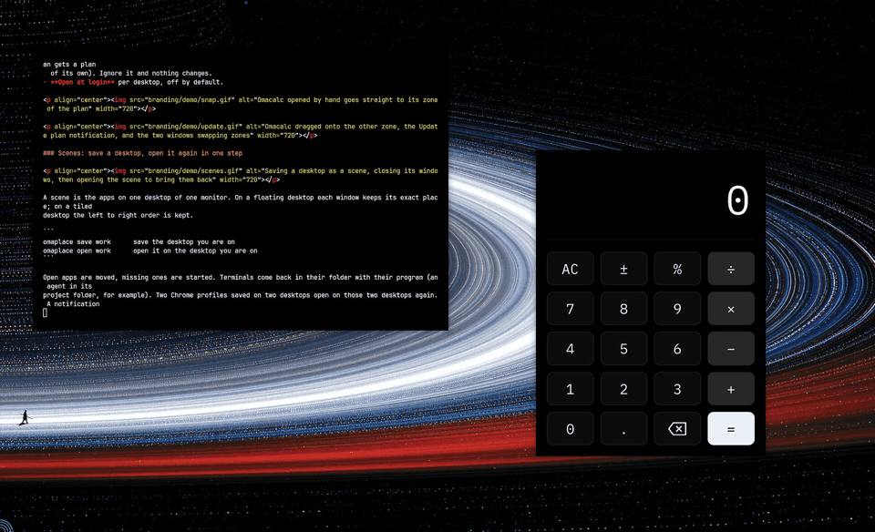
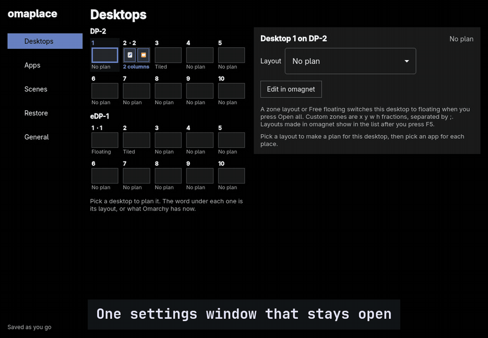

<p align="center">
  <picture>
    <source media="(prefers-color-scheme: dark)" srcset="branding/social/banner-dark.png">
    
  </picture>
</p>

<p align="center"></p>

# omaplace

Every app opens where it belongs on Omarchy: the right desktop, the right monitor, the right spot. Plan your desktops, save scenes, and bring the whole session back after a reboot.

**Status: v0.3.0.** Desktop plans, placement rules, scenes, session restore (also at login) and app memory, with monitors it recognizes again after a port change. Open items are in [docs/ROADMAP.md](docs/ROADMAP.md), feedback from daily use in [docs/feedback.md](docs/feedback.md).

Not affiliated with or endorsed by Omarchy or 37signals.

## What it does

### Desktops: a plan for each desktop

<p align="center"></p>

The settings app opens on the **Desktops** page: one tile per desktop (1 to 10) on each monitor, each with a word
that says what it is now (Tiled, Scrolling, Floating) or what its plan is. Click a card and pick a layout:

- **Zones:** 2 columns, 3 columns, 2 rows, a 2 by 2 grid, Priority, or your own zones: draw them with the mouse ("Draw zones"), or type them as text. With
  [omagnet](https://github.com/felipecpaiva/omagnet) running, its own layouts are listed by name and "Edit in omagnet"
  opens its editor instead.
- **Tiled** or **Scrolling:** the apps open in order, left to right.
- **Full screen:** one app, maximized, the bar stays.
- **Free floating:** each window at its own saved spot.

Then pick an app for each zone from your installed apps. A preview shows each app's icon in its zone.

- **Open all** starts the planned apps that are missing and moves the ones already open. A zone plan turns the desktop
  floating first.
- **Apps snap:** open a planned app by hand at any time, from anywhere, and it goes to its desktop and zone. The view
  stays where you are.
- **Update plan:** move a planned window to another zone or desktop by hand and one notification asks "Update the
  plan?". Press "Update plan" and the plan follows you (two windows swap zones, a window moved off its plan gets a plan
  of its own). Ignore it and nothing changes.
- **Open at login** per desktop, off by default.

<p align="center"></p>

<p align="center"></p>

### Scenes: save a desktop, open it again in one step

<p align="center"></p>

A scene is the apps on one desktop of one monitor. On a floating desktop each window keeps its exact place; on a tiled
desktop the left to right order is kept.

```
omaplace save work      save the desktop you are on
omaplace open work      open it on the desktop you are on
```

Open apps are moved, missing ones are started. Terminals come back in their folder with their program (an agent in its
project folder, for example). Two Chrome profiles saved on two desktops open on those two desktops again. A notification
lists what was placed, started, skipped or not reopened. Nothing fails silently.

### Session restore

While you work, omaplace keeps a snapshot of all desktops. It writes only after window events, at most once every 15
seconds, and closing everything at shutdown never erases the last good snapshot. After a reboot, `omaplace restore`
(or the button on the Restore page) brings back the previous login's desktops, each window on its own monitor and
desktop. It always picks the previous login, never the current one.

To do it by itself after a reboot, set **Restore at login** on the Restore page (or `restore_at_login` in
`config.toml`): **Ask** shows one notification with a Restore button, **Automatic** restores at once. Off is the
default. It runs only right after a real login, never on a shell restart.

### Placement rules

"This app always opens on desktop 3 of my big monitor." Add one from the app itself (`omaplace rule add` with the app
focused, or the Apps page), or by hand in `~/.config/omaplace/config.toml` (made-up app and monitor):

```toml
[rule.editor]
app = "org.example.Editor"      # the app's initial class
monitor = "Example Corp EX27"    # the monitor's name as Omarchy knows it; "laptop" = any laptop panel; empty = the focused monitor
slot = 3                        # desktop 1 to 10 on that monitor
follow = false                  # true: switch to that desktop when the app opens
rect = "0.5 0 0.5 1"            # optional: x y w h as fractions of the screen (here the right half)
keep_rect = true                # put the window there when it floats (a floating desktop); "Add rule" fills both
```

<p align="center"></p>

On the Apps page this is the **Open in the same spot** switch.

The rule follows the monitor, not the port. If the monitor is unplugged, the rule switches itself off and the app opens
as usual. It comes back when the monitor does.

### App memory

An app you open by hand goes back to where a scene last put it (`app_memory = "scene"`, the default), or to where you
last left it (`"last_place"`). With `"auto"` (set in `config.toml`, not yet offered in the window), moving an app by
hand from one scene's desktop to another's moves it between the two scenes. `"off"` turns it off.

## Requirements

- Omarchy 4.5 or newer, with the Hyprland Lua configuration and the Quickshell shell it ships (tested on Hyprland 0.56.2).
- The plugin itself needs nothing else: no network, no root, no background process of its own. `inotifywait` is used
  when installed, so the command line answers a little faster.
- The settings window is one optional package, `omaplace-settings` (see Install). Without it, everything works from
  the command line and `config.toml`.

What it reads and writes:

| Path | What |
|---|---|
| `~/.config/omaplace/config.toml` | settings and rules (a `.bak` of the file before each change) |
| `~/.config/omaplace/scenes.toml` | scenes and desktop plans (a `.bak` too) |
| `~/.local/state/omaplace/` | session snapshots, app memory, the plan lookup |
| `$XDG_RUNTIME_DIR/omaplace/` | short lived request and status files, gone at logout |
| `~/.local/share/applications/omaplace.desktop` | only taken away: the launcher entry older versions made (only a file carrying its own marker); the settings package brings its own |
| `~/.config/omarchy/extensions/omarchy-menu.jsonc` | only if you press "Add omaplace to the Omarchy menu": one block between `// omaplace begin` and `// omaplace end`, with a backup first |

It never stores window titles or web addresses. Terminal folders and program names are stored so terminals can reopen
in place; arguments that look like a password or token are dropped. `scenes.toml` is plain text, so think twice before
putting it in public dotfiles. It never edits your `hyprland.lua` or any Omarchy file, and takes no keys and no bar
space. To switch a desktop's mode it uses Omarchy's own commands.

## Install

```
omarchy plugin add https://github.com/felipecpaiva/omaplace --enable
```

Then:

1. Turn the plugin on if it is not yet (`omarchy plugin enable io.github.felipecpaiva.omaplace`), then run
   `omarchy restart shell` once. The shell loads new plugin code only on a restart (the theme picker may open, Escape
   closes it).
2. Add this line to the end of `~/.config/hypr/hyprland.lua`:

   ```lua
   pcall(dofile, os.getenv("HOME") .. "/.config/omarchy/plugins/io.github.felipecpaiva.omaplace/lua/omaplace.lua")
   ```

   The `pcall` makes sure a missing or broken file never breaks the rest of your config. Rules are read from
   `~/.config/omaplace/config.toml` when Hyprland loads.
3. The command line is `bin/omaplace` in the plugin folder. Add it to your PATH or make an alias.
4. The settings app: download `omaplace-settings-<version>-1-x86_64.pkg.tar.zst` from the
   [latest release](https://github.com/felipecpaiva/omaplace/releases/latest), then install it:

   ```
   sudo pacman -U omaplace-settings-*.pkg.tar.zst
   ```

   Or build it from this repository (needs `qt6-base`, `qt6-declarative`, `qt6-wayland`, `gcc`, `make`, `python`):
   `cd app && bin/install`.

## Settings

Open **omaplace** from the app launcher, or run `omaplace settings`. It is a normal window: it floats, stays open while
you arrange your apps, and opening it again brings it to the front. Five pages:

- **Desktops:** the map of every desktop on every monitor, and the plan of the one you pick (above).
- **Apps:** where an app always opens (rules: monitor, desktop, follow, same spot), where apps you open yourself go
  (app memory), and apps omaplace leaves alone.
- **Scenes:** open, rename, delete, and see each window. Pick a browser profile or a project folder for a window
  omaplace could not tell. What a scene does with apps already open and with a missing monitor.
- **Restore:** restore the last session, restore at login, the snapshot switch, and older sessions.
- **General:** the Omarchy menu, the timings (Advanced), and About.

Keys: Ctrl+1 to Ctrl+5 for the pages, F5 reads the desktops again, ? or F1 lists the keys, Ctrl+W closes.

<p align="center"></p>

Every change is saved at once; the file before the change is kept as `.bak` next to it.

The command line:

```
omaplace save <name>        save the desktop you are on as a scene
omaplace save --ask         same, asking for the name in the Omarchy menu (Enter alone: the desktop's name)
omaplace open <name>        open a scene on the desktop you are on (a desktop plan opens on its own desktop)
omaplace open --pick        pick the scene from a list
omaplace restore [n]        bring back the last session (n = 1 for the one before, 2 ...)
omaplace list | rename <from> <to> | remove <name>
omaplace rule add           the focused app always opens on this desktop and monitor
omaplace rule remove <name>
omaplace status
omaplace settings           open the settings app
```

`--json` before the word prints the service's answer as is. Exit codes: 0 ok, 2 bad usage, 3 not found or nothing to
save, 4 partial, 5 failed, 6 the Lua module is not loaded, 7 the plan could not take the move (`plan-update`, used by
the "Update plan" button).

**Omarchy menu.** omaplace never touches the Omarchy menu by itself. In the settings app, on General, press "Add omaplace to the Omarchy
menu" for a Scenes menu with Save this desktop, Open a scene, Restore last session, Always open here and Settings.
"Remove from the menu" takes the block out again and leaves the rest of the file alone.

## Known limits

- Switching a desktop's mode: until Omarchy has a command to set the mode of any desktop
  ([omacom/omarchy#19671](https://github.com/omacom/omarchy/pull/19671)), "Open all" focuses that desktop and presses
  Omarchy's layout toggle (at most twice). At login it cannot do that, so the mode is left as it is and the summary says so.
- Open at login and Restore at login passed two real reboots. The last two fixes (restore before the plans, app names
  in any letter case) are checked by hand, not yet by a third reboot.
- The settings app is checked by offscreen tests that click every control (against a stand-in for the plugin) and by a
  read-only run against the real plugin. Its real window (floating, one instance, the launcher) is checked by hand
  once installed. Pressing "Update plan" with a real click is not checked yet.
- A Chrome window opened from Chrome's own profile menu cannot be placed by profile: its profile cannot be seen. On a
  restore, such a window opens with the profiles Chrome had open when it last closed.
- Two windows of the same app in one plan are placed by order, not by content.
- A `scenes.toml` made by hand while the shell runs is picked up by the next command or settings open, not at once.
- Apps restore their own contents (browser tabs, documents). omaplace places windows, it does not restore what is in them.

## Uninstall

1. If you added the menu: press "Remove from the Omarchy menu" in the settings app first, or delete the lines from
   `// omaplace begin` to `// omaplace end` in `~/.config/omarchy/extensions/omarchy-menu.jsonc` by hand.
2. Delete the `pcall(dofile, ...)` line from `hyprland.lua`.
3. Run `omarchy plugin remove io.github.felipecpaiva.omaplace`, and remove the `omaplace-settings` package with pacman
   if you installed the settings app.
4. If you want, delete `~/.config/omaplace`, `~/.local/state/omaplace` and
   `~/.config/omarchy/extensions/omarchy-menu.jsonc.omaplace.bak`.

## Tests

```
bash tests/run-all.sh
bash tests/scrub.sh
```

Lua 5.5 (like Hyprland) and Node. A linter that is not installed prints `SKIP <tool> not installed`. Hand checks are in
[docs/validation-checklist.md](docs/validation-checklist.md). How it is built: [docs/design.md](docs/design.md).

Sister projects: [omagnet](https://github.com/felipecpaiva/omagnet) (window snapping and zones for floating
workspaces) and [omahop](https://github.com/felipecpaiva/omahop) (Alt+Tab for floating workspaces).

## License

MIT, see [LICENSE](LICENSE).
