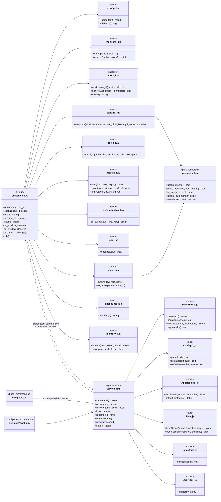
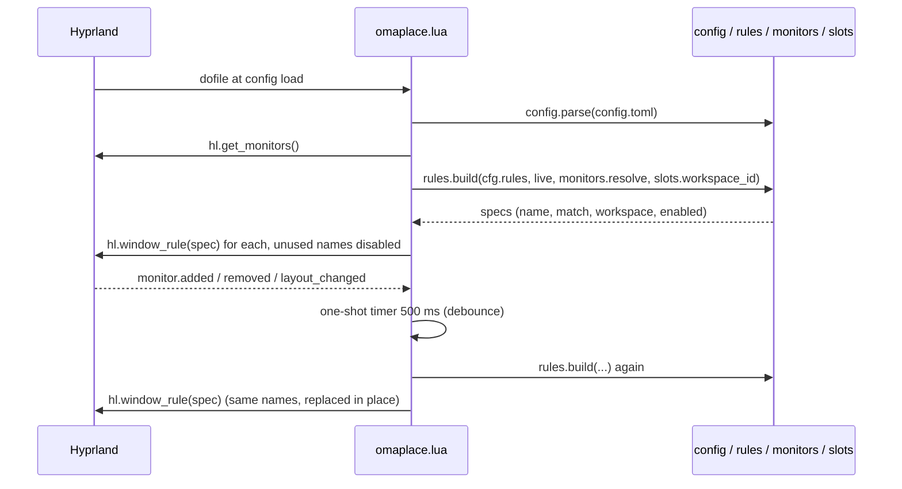
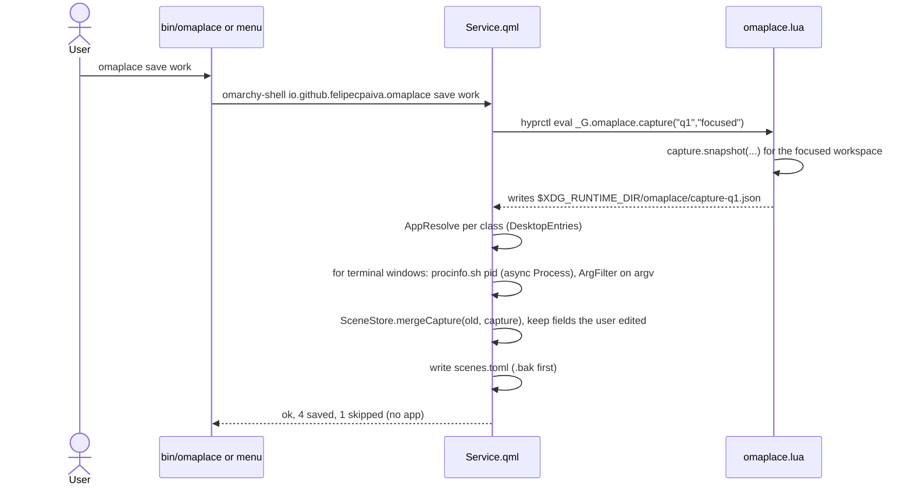
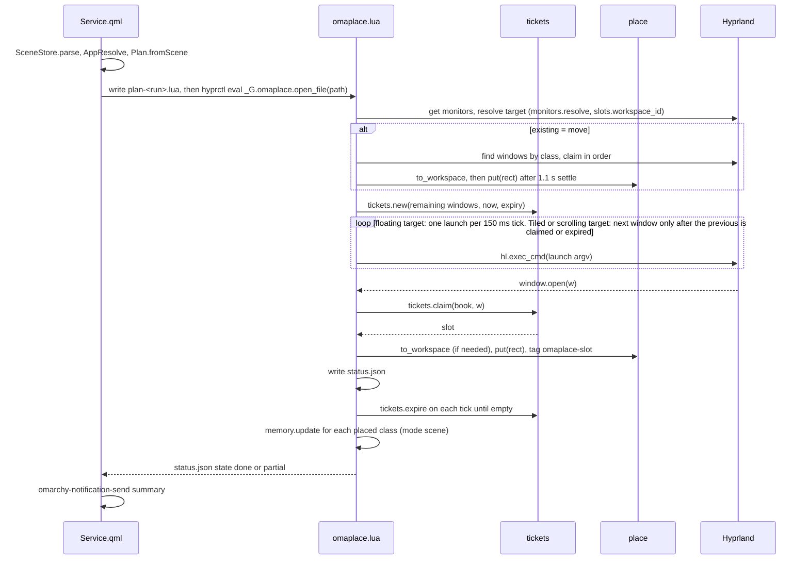
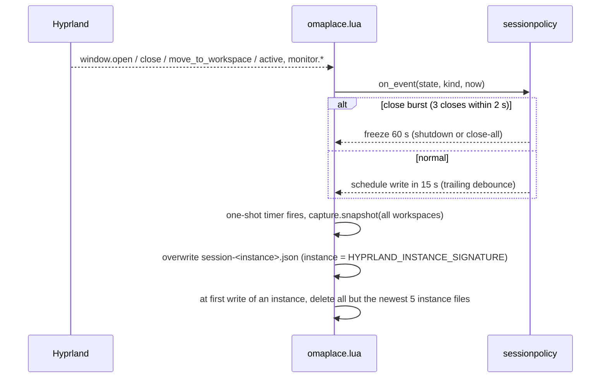

# omaplace design

Status: **draft for review**, 2026-11-21. Source of truth from now on; it supersedes `research.md` and the research files
where they disagree (each place is named in section 12). Target: Omarchy 4.5, Hyprland **0.56.2** (installed). Re-check the
0.57 notes in `research/02` before moving on.

Evidence for every choice is in [research/](research/). Engineering rules are in
[engineering-standards.md](engineering-standards.md); a work package is not done until it meets them.

## 1. What omaplace does

| # | Feature | Milestone |
|---|---|---|
| F1 | **Placement rules.** "App X always opens on slot N of monitor M." Applied every time the app opens. | M1 |
| F2 | **Scenes.** Save the apps on one workspace of one monitor, with exact places and sizes. Open a scene in one step. | M2 |
| F3 | **Session.** omaplace keeps a snapshot of all workspaces by itself. "Restore last session" opens it. | M3 |
| F4 | **Monitor identity.** Rules, scenes and the session find their monitor again after a port change, a dock or an unplug. | M1, used by all |
| F5 | **App memory.** An app opened by hand goes back to its remembered desktop, monitor and spot ("Slack: desktop 2, right three quarters, floating"). Setting `app_memory`: `scene` (default), `last_place`, `auto` | M2 (`scene`, `last_place`), M4 (`auto`) |

What it never does: patch Omarchy, edit the user's Hyprland files, run on a timer, store window titles or unfiltered arguments,
take default keys, or add a bar icon by default.

Gap this fills (checked in source, `research/08`, `research/09`): no project has F1 with a monitor choice, and none
combines exact geometry with a port-proof monitor identity outside tmux windows.

## 2. Principles (from Felipe, binding)

1. **Extend, never replace.** Only documented Omarchy seams (section 3). Nothing under `/usr/share/omarchy`, no edits to
   `~/.config/hypr/*`, no systemd units, no global Hyprland options, no Omarchy state files written.
2. **Code standards per language.** See [engineering-standards.md](engineering-standards.md).
3. **Minimum resources.** Event driven. No polling. No resident process of our own. No extra runtime (no Python, no Node at
   run time, no compiled binary). Idle cost is a few event handlers that return at once.
4. **Isolation of concerns.** Capture, storage, app resolution, monitor resolution, matching, launching, placing and UI are
   separate modules with one job each. Pure logic never calls Hyprland. Each file has one writer.
5. **Flexibility and scale.** Behaviour is a setting with a safe default. Users extend the app strategy table without code.
   Works with 100+ windows and several monitors.
6. **Privacy.** No titles and no URLs. Terminal folders and program names are captured (D12) so terminals and agents reopen in place; arguments pass a secret filter first, and the settings window shows what was captured.

## 3. Where omaplace plugs into Omarchy

| Seam | How omaplace uses it | Who writes it |
|---|---|---|
| Plugin folder `~/.config/omarchy/plugins/io.github.felipecpaiva.omaplace/` (folder name = manifest id, like omagnet) | Installed by `omarchy plugin add`. Holds everything, including the Lua module and the CLI | the installer |
| One line in the user's `hyprland.lua` | `pcall(dofile, os.getenv("HOME") .. "/.config/omarchy/plugins/io.github.felipecpaiva.omaplace/lua/omaplace.lua")`, added by the user from the README, same as omagnet and omahop | the user |
| Hyprland Lua API (`hl.on`, `hl.window_rule`, `hl.dsp`, `hl.get_*`, `hl.exec_cmd`, `hl.timer`) | Events, named rules, placement | omaplace Lua |
| `o.workspaces.workspace_id(monitor, slot)` (`/usr/share/omarchy/default/hypr/monitor-workspaces.lua:298`, exported as `o.workspaces`) | Turn "monitor + slot" into a workspace id. Read through one adapter (`slots.lua`) only | Omarchy |
| `uwsm-app -- <desktop-id>` and Omarchy launchers (`omarchy-launch-webapp`, `omarchy-launch-tui`, `xdg-terminal-exec`) | Launch apps the way Omarchy does (`uwsm-app` is Omarchy's form; `uwsm app` takes a desktop entry id, checked in its help) | Omarchy |
| Shell plugin `service` and `panel` kinds; the service's own `IpcHandler` target, called with `omarchy-shell io.github.felipecpaiva.omaplace <method> <args>` (7.2), and `omarchy-shell shell toggle <id>` for the panel | Storage, app resolution, CLI target, settings window | omaplace QML |
| `~/.config/omarchy/extensions/omarchy-menu.jsonc` (read by `shell/plugins/menu/Menu.qml:57`) | One "Scenes" menu, added only when the user presses "Add to menu" in settings, with a backup first | omaplace, with consent |
| `omarchy-notification-send` | Result of an open or restore | omaplace QML |
| `_G.omagnet.fit_shadow` (optional) | After placing, if omagnet is loaded, looked up at use time inside `pcall` | omagnet |

Never touched: `autostart.lua`, `bindings.lua`, `monitors.lua`, `hyprland.lua` (beyond the user's own line),
`~/.local/state/omarchy/**`, `omarchy-system`, the dock, Omarchy's `omarchy-floating-open-*` rules.

## 4. Architecture

Two halves, one contract. The **Lua module** runs inside Hyprland and owns everything that needs the live desktop: events,
rules, capture, monitor and slot resolution, matching, launching and placing. The **shell plugin** (QML plus pure JS) owns
everything that needs files and the desktop entry database: the scene store, settings, app resolution, the CLI target, the
settings window and notifications. Lua cannot list folders or read desktop entries; the shell cannot see `window.open`.
So the split follows the platform, not taste.

```
 user                                                                           Hyprland
  | menu row / CLI bin/omaplace / settings window                                   ^
  v                                                                                 | events, rules, dispatch
 +--------------------- shell plugin (QML + JS, in omarchy-shell) ----+   +--------+------- Lua module (in Hyprland) ------+
 | Service.qml  (IPC target, the only place that talks to Lua)        |   | omaplace.lua (glue: the only file calling hl)  |
 |   SceneStore.js  ConfigIO.js  AppResolve.js  Plan.js  LuaLiteral.js|   |   config  geometry  monitors  slots  capture   |
 | SettingsPanel.qml (loaded on demand)                               |   |   rules  tickets  sessionpolicy  json  place   |
 +--------------------------------------------------------------------+   +------------------------------------------------+
        |  writes scenes.toml, config.toml           hyprctl eval (async Process, argv, no shell)  ^
        |  reads capture.json, status.json  <------- files in $XDG_RUNTIME_DIR/omaplace/  <-------+ writes
        |  reads session/*.json            <------- files in ~/.local/state/omaplace/     <-------+ writes
```

### 4.1 Files and their single writer

| File | Format | Writer | Readers | Holds |
|---|---|---|---|---|
| `~/.config/omaplace/config.toml` | TOML subset (omagnet's) | `ConfigIO.js` | Lua `config.lua`, `ConfigIO.js` | Settings and placement rules |
| `~/.config/omaplace/scenes.toml` | TOML subset, numbered sections | `SceneStore.js` | `SceneStore.js` only | Named scenes |
| `~/.config/omaplace/*.bak` | copy | `SceneStore.js`, `ConfigIO.js` | user | One level of undo |
| `~/.local/state/omaplace/session-<instance>.json` (one per Hyprland instance, overwritten in place, last 5 instances kept) | JSON | Lua glue | `Service.qml` | Session snapshots |
| `$XDG_RUNTIME_DIR/omaplace/capture-<req>.json` | JSON | Lua glue | `Service.qml` | One capture answer |
| `$XDG_RUNTIME_DIR/omaplace/status.json` | JSON | Lua glue | `Service.qml` | Progress of the current run |
| `~/.local/state/omaplace/memory.lua` | Lua table literal (Lua reads its own file with `loadfile` in an empty environment) | Lua glue | Lua glue, `Service.qml` (display) | App memory per class |
| `$XDG_RUNTIME_DIR/omaplace/moves.json` | JSON | Lua glue | `Service.qml` | Moves between scene desktops (`auto` mode only) |
| `$XDG_RUNTIME_DIR/omaplace/plan-<run>.lua` | one Lua table literal (`return { ... }`) | `Service.qml` | Lua glue (`load` with an empty environment, text mode only) | The plan of one run (S1: `hyprctl eval` arguments are capped at 128 kB by Linux, so plans go through a file) |
| `$XDG_RUNTIME_DIR/omaplace/result-<req>.json` | JSON | `Service.qml` | `bin/omaplace` | Final answer of a slow request (save, open, restore) |

Scenes are TOML (decision D2) because users keep them in dotfiles and edit them; only JS reads them, and JS hands Lua a
ready plan, so Lua never needs a scene parser. Lua writes JSON because it only encodes (a 40-line pure encoder) and JS
reads JSON natively. Config is read by both sides, so it stays in the family TOML subset with a cross-check test, like
omagnet.

### 4.2 Module diagram

Modules, not classes. `<<pure>>` = no Hyprland, no files, unit tested with plain `lua` or Node. `<<hl>>` = touches
Hyprland, tested with a fake `hl`. `<<qml>>` = runs in the shell, checked live or by hand.



### 4.3 Responsibilities, one line each

| Module | Job | Must not |
|---|---|---|
| `lua/omaplace.lua` | Register events, own timers, call `hl`, read and write omaplace files, expose `_G.omaplace` | Hold logic that can be pure |
| `lua/config.lua` | Parse config.toml subset, apply defaults, report bad values | Touch `hl` or files |
| `lua/geometry.lua` | Rect math, fractions of the usable area. Header names the omagnet commit it was copied from | Diverge from omagnet without the parity test failing |
| `lua/monitors.lua` | Fingerprint a monitor, resolve a fingerprint to a live monitor with a named fallback step | Read Omarchy state files |
| `lua/slots.lua` | The only code that knows Omarchy's workspace model | Be called with a global id as if it were a slot |
| `lua/capture.lua` | Turn live windows and monitors into a snapshot (class, rect fraction, left-to-right order, slot, flags) | Store titles, pids, addresses |
| `lua/rules.lua` | Turn config rules plus live monitors into named rule specs (enabled or disabled) | Call `hl.window_rule` itself |
| `lua/memory.lua` | App memory: update the remembered place of a class from a run, a close or a move (by `app_memory` mode); look up a place for a new window | Touch files or `hl` |
| `lua/shellquote.lua` | Turn a plan argv into one safely single-quoted command string for `hl.exec_cmd` (captured and edited fields included) | Pass any string unquoted |
| `lua/tickets.lua` | Match new windows to waiting slots by class (and context, one live context per class with a quiet window), in order, with expiry | Use title, pid or address as identity |
| `lua/sessionpolicy.lua` | Decide when to write a session snapshot (debounce, close-burst freeze) | Read the clock or write files |
| `lua/json.lua` | Encode tables to JSON | Decode (not needed) |
| `lua/place.lua` | Resize, then move, check the size, retry at most twice; leave fullscreen first; settle after a workspace move | Decide where a window goes |
| `Service.qml` | IPC methods, run `hyprctl eval` as an async `Process` with argv, watch status and capture files, notifications | Parse or build data by hand (calls the JS modules) |
| `js/SceneStore.js` | Read, write, migrate scenes.toml; merge a re-capture without losing fields the user edited | Know about Hyprland |
| `js/ConfigIO.js` | Read and edit config.toml line by line, keep unknown keys | Rewrite the whole file |
| `js/AppResolve.js` | Class plus desktop entry list plus strategy table to a launch recipe | Read `/proc` |
| `js/ArgFilter.js` | Drop arguments that look secret (`--password`, `--token`, `KEY=value`, long random strings, URLs with credentials) | Keep anything it is unsure about |
| `libexec/procinfo.sh` | Given a terminal pid, print JSON with the foreground program's folder and argv (`/proc`, read only) | Run anything; print anything else |
| `js/Plan.js` | Scene or snapshot plus launch recipes to the plan Lua runs | Know file paths |
| `js/LuaLiteral.js` | Safe Lua table literal (escapes every string) | Emit code other than one table |
| `bin/omaplace` | Map CLI words to IPC calls, print results, set exit codes | Hold logic |
| `SettingsPanel.qml` + pages | Scenes, Rules, Session, General pages; the "Add to menu" consent | Write files except through `Service.qml` |

## 5. Data model

All examples are made up.

### 5.1 Monitor fingerprint (F4)

```
{ identity = "Example Corp EX27", make = "Example Corp", model = "EX27", serial_hash = "a1b2c3",
  internal = false, width = 2560, height = 1440, scale = 1.25, transform = 0, last_connector = "DP-2" }
```

`identity` is Omarchy's own key: the description, with ` #2`, ` #3` added for later twins (the first twin has no suffix). `serial_hash` is a short hash, never the serial.

`monitors.resolve(fp, live, policy)` tries, in order, and returns which step matched:

1. `identity` equal.
2. make, model and serial_hash equal.
3. make and model equal, only one such monitor live.
4. `internal` equal and true (laptop panel).
5. Same shape class (aspect within 2 percent, size within 10 percent).
6. Policy `missing_monitor`: `focused` (default for scenes) or `skip` (default for rules).

### 5.2 Rule (config.toml)

```toml
[rule.editor]
app = "org.example.Editor"      # matched against initialClass
monitor = "Example Corp EX27"    # identity; "laptop" = any laptop panel (D25); empty = the focused monitor (the rule follows focus)
slot = 3                        # 1..10 inside that monitor's block
follow = false                  # true: switch to the workspace when it opens
enabled = true
```

`rect = "x y w h"` (fractions of the usable area) and `keep_rect = true` (D27) also put the rule's first window at that
rect once it floats on the rule's desktop; "Add rule" from a floating window fills both. Exact size and place are done by dispatch after open,
never by a rule `move`/`size` effect, so Omarchy's own open rules can never fight it (they are rebuilt at runtime,
`workspace-modes.lua:279,387,409`, so rule order is not stable).

### 5.3 Scene (scenes.toml)

```toml
schema = 1

[scene.work]
existing = "move"            # move | new
home_monitor = ""            # empty: open on the current monitor; else an identity
home_slot = 0                # 0: current workspace; else 1..10
key = ""                     # optional, user picked
saved_on = "Example Corp EX27"

[scene.work.window.1]
app = "org.example.Editor"   # desktop entry id, from AppResolve at capture
class = "org.example.Editor" # initialClass, the match key
context = ""                 # optional: profile or project folder (5.4a)
rect = "0 0 0.5 1"           # x y w h fractions of the usable area (used on floating workspaces)
order = 1                    # left-to-right rank (used on tiled and scrolling workspaces)
floating = true
launch = ""                  # captured program after ArgFilter, or typed
folder = "~/code/demo"       # captured from the terminal (D12); shown in settings
```

### 5.4a Context: many windows of one app (D18)

Chrome runs every profile in one process, and its normal windows share one class (`google-chrome`) and show no profile in
the title [tested 2026-11-21: 4 windows, 1 pid, profile not in titles]. Its web apps already differ by class
(`chrome-<id>-Default`, the suffix is the profile). IDEs and terminals have the same problem with project folders. So a slot
has an optional **context**: the thing that tells two windows of one app apart.

| App kind | Context | Launch with context | Where the context comes from at save |
|---|---|---|---|
| Chromium browsers (Chrome, Brave, Chromium, Edge) | profile directory (`Default`, `Profile 1`); display name read from the browser's `Local State` for the UI | `<browser> --profile-directory=<ctx> --new-window` | the window's `omaplace-ctx` tag if omaplace opened it; else the user picks once in settings |
| Firefox | profile name | `firefox -P <ctx> --new-window` (S10) | tag, else pick once |
| IDEs (VS Code family, agentic IDEs) | project folder | `<ide> --new-window <folder>` | tag, else pick once (titles are never read) |
| Terminals and TUIs | folder and program (D12) | as in 5.7 | `procinfo.sh` |

Rules:

1. **Launch one context at a time per class.** After launching context X, every new window of that class that opens before
   the class is quiet for `context_quiet_ms` (default 2000) belongs to X. This also catches windows the browser restores
   by itself for that profile. Different classes still launch in parallel.
2. **Tag on claim**: `omaplace-ctx=<hex of the context>`. Tags die with the window, so a later save knows each window's
   context without reading titles.
3. **Unknown context at save** (a window the user opened from the browser's own profile menu): saved with
   `context = "?"`; the result says "2 Chrome windows need a profile" and the settings window offers a picker of the
   profiles found. After that the slot is known.
4. **Moving existing windows** (`existing = move`) only claims windows whose tag matches the slot's context. Untagged
   windows of a context app are left alone, never guessed.
5. **App memory and rules** key on class plus context. A Hyprland rule cannot see a profile when a window opens, so a
   context rule only places windows omaplace launched; windows opened from the browser's own menu are not placed (stated
   in the UI).
6. The strategy table (5.7) gets `context = "profile" | "folder" | "none"` and a `launch_context` template per entry, so new
   multi-profile apps are added as data.

### 5.4 Plan (JS to Lua, as one Lua table literal in a file)

```lua
{ run = "r-20261121-1", target = { fp = {...}, slot = 0 }, existing = "move", expiry_s = 20,
  layout = "floating",   -- floating: place rects; tiled or scrolling: sequential, in order, no rects
  windows = {
    { class = "org.example.Editor", order = 1, rect = {0, 0, 0.5, 1}, floating = true,
      launch = { "uwsm-app", "--", "org.example.Editor.desktop" }, mode = "launch" },
    { class = "chromium", order = 2, rect = {0.5, 0, 0.5, 1}, floating = true, mode = "place_only" },
  } }
```

`order` is the left-to-right rank at capture (by `x`, then `y`), saved for every window. On a floating target the run may
launch in parallel ticks and place by rect. On a tiled or scrolling target (`layout` from Omarchy's workspace mode) the run
is sequential: the next window is launched or moved only after the previous one is claimed or expired. Dwindle still
splits the focused window, so the order can come out wrong (S8); when the last window is in, the run reads each window's
`at`, and swaps windows with `hl.dsp.window.swap({ window = ..., target = ... })` until the left-to-right order matches.
Rects are ignored there. At the end of any run the view goes back to the target workspace (or the last rule desktop, D9),
because an app can open on another workspace and pull the view with it (S9).

`mode`: `launch` (start it if no window to move), `place_only` (never start; apps that restore themselves),
`skip` (unresolved app, reported). `launch` is always an argv array; Lua joins it with `shellquote.join` (every element
single quoted, `'` written as `'\''`) because `hl.exec_cmd` takes one string.

### 5.5 Snapshot (Lua to JS, capture and session)

```json
{ "schema": 1, "kind": "session", "saved_at": 1763700000, "mode": "per_monitor",
  "monitors": [ { "fp": { "identity": "Example Corp EX27", "internal": false } } ],
  "windows": [ { "class": "org.example.Editor", "monitor": 0, "slot": 2, "order": 1, "rect": [0, 0, 0.5, 1],
                 "floating": true, "fullscreen": 0, "minimized": false } ] }
```

### 5.6 Status (Lua to JS)

```json
{ "run": "r-20261121-1", "state": "running", "items": [
  { "class": "org.example.Editor", "state": "placed" },
  { "class": "org.example.Mail", "state": "waiting", "since": 1763700001 } ] }
```

Item states: `waiting`, `placed`, `moved`, `skipped`, `not_reopened` (ticket expired), `failed` (with a reason code).
Run states: `running`, `done`, `partial`, `interrupted` (Lua reloaded mid-run).

### 5.7 App strategy table (AppResolve, user extendable)

| Strategy | When | Launch |
|---|---|---|
| `desktop` (default) | Class maps to a desktop entry (omahop's lookup chain: id, StartupWMClass, lower case, last part of a reverse DNS id) | `uwsm-app -- <id>.desktop` |
| `webapp` | Class `chrome-*-Default` and a matching web app desktop entry | the entry id through `uwsm-app --` |
| `terminal` | A terminal class; `folder` and foreground program captured (D12) | `uwsm-app -- xdg-terminal-exec --dir=<folder> <program argv>` |
| `tui` | Class `org.omarchy.<cmd>` | `omarchy-launch-tui <cmd>` |
| `context` | Multi-profile browsers and multi-folder IDEs (5.4a): google-chrome, chromium, brave, firefox, code and its forks | the entry's `launch_context` template, one context at a time per class |
| `place_only` | Apps that restore their own windows and have one window identity (default list: obsidian, spotify; Slack left out 2026-11-22: it does not start itself at login here, so a restore starts it once from its desktop entry) | none |
| `command` | A `launch` the user typed or edited | that argv through `uwsm-app --` |

Users add `[strategy.<name>]` sections in config.toml (`match = "class pattern"`, `use = "<strategy>"`). Unknown classes with
no entry are `skip` and listed in the result, never guessed.

## 6. Interactions

### 6.1 Rules at load and on monitor change (F1, F4)



### 6.2 Save a scene (F2)



### 6.3 Open a scene (F2)



**Rules vs scenes (D9, Felipe).** A rule wins, like macOS "Assign to desktop". An app in the scene that has a rule opens
(or is moved) on the rule's desktop and monitor, and the focus follows it; every other app goes to the scene's target. If
several apps have rules on different desktops, the focus ends on the last one placed. The run still claims the window by
ticket, so on a floating desktop it also gets the scene's rect there.

**App memory (F5).** A new window that no run claims is checked against `memory.lookup`. It is placed only if it is the
first window of its class (so a browser's second window is left alone), not modal, and not on a special workspace. A rule's
desktop beats the memory's desktop; the memory's rect is used when the desktop is the same and floating.

| `app_memory` | Memory updated when |
|---|---|
| `scene` (default) | a run places the app |
| `last_place` | also when the app's last window closes or moves to another desktop |
| `auto` (M4) | as `last_place`, and a move between two desktops that each show an opened scene moves the app from one scene to the other in `scenes.toml` (the service does the write, Lua only reports the move) |

### 6.4 Session snapshot (F3)



Staleness limit (stated, not hidden): Hyprland has no move or resize event, so a window dragged and then left alone is saved
with its old rect until any later event (focus change, open, close). In normal use focus changes come within seconds.
`omaplace session save` saves at once.

Why one file per Hyprland instance: a reboot starts a new instance, so the new session writes a new file and never
overwrites the last session of the previous boot. A shift-on-every-write ring would push the pre-reboot snapshot out
within minutes.

### 6.5 Restore the session (F3)

Default source: the newest session file whose instance is **not** the current one (the previous login). `restore GEN`
picks an older one. Same as 6.3, with `Plan.fromSession`: each window goes to its own saved monitor and slot (not the current one), resolved
through `monitors.resolve` with policy `focused`. Restore at login: setting `restore_at_login` (D26), off by default.

## 7. Interfaces (contracts the builders code against)

### 7.1 Lua API on `_G.omaplace`

| Call | Returns | Notes |
|---|---|---|
| `open(plan)` | run id string, or `nil, err` | Starts a run; one run at a time, a second call answers `busy` |
| `open_file(path)` | same as `open` | Reads `plan-<run>.lua` with `load(text, "plan", "t", {})` (no globals, no bytecode), then `open`. The service always uses this form |
| `capture(req_id, scope)` | `true` | `scope`: `focused` or `all`; writes `capture-<req_id>.json` |
| `reload_config()` | `true` or `nil, err` | Re-reads config.toml, rebuilds rules |
| `session_save_now()` | `true` | Ignores the debounce, not the freeze |
| `status()` | table | Same as status.json |
| `version` | string | For the service to check compatibility |

### 7.2 Service IPC (`omarchy-shell io.github.felipecpaiva.omaplace <method> ...`)

Form (S5, checked 2026-11-21): `Service.qml` declares its own `IpcHandler { target: "io.github.felipecpaiva.omaplace" }`
with typed functions (`function save(name: string): string`), the same way the Spaces plugin does. The CLI calls
`omarchy-shell io.github.felipecpaiva.omaplace <method> <args>`. Not `omarchy-shell shell call`: that only reaches panels
that are open right now (`shell.qml` `callIfLoaded`), never a service. An unknown target or method prints `Target not found.`
or `Function not found.` and exits 1; the default timeout is 2 s (`OMARCHY_SHELL_IPC_TIMEOUT`). Methods answer at once and
never wait.

| Method | Arg | Immediate answer |
|---|---|---|
| `save` | scene name | `{"ok":true,"pending":true,"req":"q7"}` |
| `open` | scene name | same, pending |
| `restore` | generation or `""` | same, pending |
| `list` | `""` | `{"ok":true,"scenes":[...]}` |
| `rename` | `{"from":"a","to":"b"}` | `{"ok":true}` |
| `remove` | scene name | `{"ok":true}` |
| `ruleAddFocused` | `""` | pending (needs a capture) |
| `ruleRemove` | rule name | `{"ok":true}` |
| `status` | `""` | current status JSON |

A pending request ends with `result-<req>.json`, written by the service when the Lua side reports done, partial or
failed, or after `request_timeout_s`. Errors use `{"ok":false,"code":"not_found|busy|no_lua|bad_name|empty|failed"}`
(`empty`: a save found nothing to save on the desktop).

### 7.3 CLI `bin/omaplace`

Words: `save`, `open`, `restore`, `list`, `rename`, `remove`, `rule add`, `rule remove`, `status`, `settings`. `save --ask` and `open --pick` (the menu rows, WP8) take the name from `omarchy-menu-input` and
`omarchy-menu-select`; a closed picker exits 0 and does nothing. For a
pending answer the CLI waits for `result-<req>.json`: with `inotifywait` when installed, else a check every 200 ms, never
longer than `request_timeout_s`. This short wait lives only while the user's command runs; nothing resident polls. Exit codes: 0 ok, 2 bad usage, 3 not found or nothing to save, 4 partial (some windows not placed), 5 failed,
6 Lua module not loaded (`_G.omaplace` missing: prints the README line to add). Plain text output by default, `--json` passes
the IPC line through. The CLI lives in the plugin folder; the menu row calls it by full path. Users may alias it.

### 7.4 Window tag

Placed windows get `omaplace-slot=<run>/<n>`. It stops a window being claimed twice and lets omagnet or omahop step aside later.

### 7.5 Settings (config.toml, top level)

| Key | Default | Note |
|---|---|---|
| `schema` | 1 | |
| `missing_monitor_scene` | `focused` | |
| `missing_monitor_rule` | `skip` | |
| `existing_default` | `move` | D10 |
| `expiry_seconds` | 20 | |
| `settle_ms` | 1100 | |
| `launch_tick_ms` | 150 | |
| `session` | `on` | D15 |
| `session_debounce_s` | 15 | |
| `session_keep` | 5 (Hyprland instances, not writes) | |
| `request_timeout_s` | 60 | |
| `restore_at_login` | `off` | `off`, `ask`, `auto` (D26) |
| `app_memory` | `scene` | `scene`, `last_place`, `auto`, `off` |
| `context_quiet_ms` | 2000 | D18 |
| `tiled_order` | `true` (on tiled and scrolling workspaces, open or move windows one at a time in saved order) | |
| `ignore` | `""` | |

## 8. Performance budget

| Item | Budget |
|---|---|
| Idle | No timers armed, no process started. Event handlers return in under 0.1 ms when nothing is waiting |
| Rule rebuild | Only on config reload and monitor change, debounced 500 ms |
| Session write | At most one per 15 s, only after events, under 5 ms for 100 windows |
| Open a scene | One launch per 150 ms; no `hyprctl` from Lua; no sync process anywhere |
| Shell | The service is small and resident (the shell already runs); the settings panel loads on demand |
| Memory | No new process. No Quickshell overlay |

Any work package that adds per-event work records a measurement in `docs/batch-log/WP<n>.md`.

## 9. Decisions

| # | Decision | Status |
|---|---|---|
| D1 | Separate private plugin, not inside omagnet; copy four geometry functions with a parity test (`research/07`) | decided |
| D2 | Scenes and config in the family TOML subset; Lua output in JSON; plan passed as a Lua literal | decided |
| D3 | Match new windows by `initialClass` and ticket order only; never title, pid or address (`research/02`, `04`) | decided |
| D4 | Exec rules are not used (lost through `uwsm-app`); spawn then claim | decided |
| D5 | Slot to workspace id only through `o.workspaces.workspace_id`, behind `slots.lua` | decided |
| D6 | Rules set the workspace only; rects are dispatched after open | decided |
| D7 | Saves are event driven with a debounce and a close-burst freeze; no periodic timer (supersedes `autosave_minutes` in 06) | decided |
| D8 | Rules rebuild on monitor events; scenes and sessions resolve monitors only when opened | decided |
| D9 | Scene opens on the current desktop and monitor; an app with a rule goes to the rule's desktop and the focus follows it (last one wins) | decided (Felipe) |
| D10 | Already-open apps are moved, missing ones launched (`existing = move`) | decided (Felipe) |
| D11 | One `scenes.toml` for all scenes | decided (Felipe) |
| D12 | Terminal folders and foreground programs are captured automatically (agents and editors reopen in their folder), arguments through `ArgFilter`, shown in settings, warning that `scenes.toml` may land in dotfiles | decided (Felipe) |
| D13 | Floating workspaces: exact rects. Tiled and scrolling workspaces: no forced rects; restore the apps and keep their left-to-right order by opening or moving them one at a time in saved order | decided (Felipe, 2026-11-21) |
| D14 | Soft link to omagnet (`fit_shadow`, slot tag) | decided (Felipe) |
| D15 | Session snapshot and manual restore in this plan as M3; restore at login off | decided (Felipe, 2026-11-21) |
| D16 | Private now; code written public-safe (scrub test from day one) | decided (Felipe) |
| D18 | Context for many windows of one app (Chrome profiles, IDE folders): launch one context at a time per class, tag on claim, pick once when unknown, never read titles | decided (Felipe asked, design 2026-11-21) |
| D17 | App memory (F5) with setting `app_memory` = `scene` (default) / `last_place` / `auto` | decided (Felipe) |

## 10. Spikes (live checks, approved by Felipe 2026-11-21 on the condition that each is asked for right before it runs; one harmless window, no input events)

| # | Question | How to check | Gates |
|---|---|---|---|
| S1 | Is `hyprctl eval` happy with a 10 kB Lua literal argument? | done 2026-11-21: 12 kB passes intact (quotes and backslashes), 148 kB is refused by Linux (one argument max 128 kB), so plans go through a file (`open_file`) | WP5 |
| S2 | Does `window.open` arrive for an app started by `uwsm-app -- <id>.desktop`, and how long after? | done 2026-11-21: yes, after about 0.2 s, with `initial_class` and `workspace` set | WP4 |
| S3 | Does a single-instance app that only raises an old window send `window.open`? | done 2026-11-21: Slack started again sends no `window.open` (ticket expires, `existing = move` handles it); Omacalc opens a second window | WP4 |
| S4 | Does our dispatch after Omarchy's open rule land the exact rect on a floating workspace? | done 2026-11-21: yes, resize then move by address landed exactly (800x487 at 800,513) after Omarchy's open placement | WP4 |
| S5 | What does `omarchy-shell shell call` print and return for a third-party service? | done 2026-11-21: `shell call` reaches open panels only; a plugin's own `IpcHandler` target works (see 7.2) | WP5 |
| S6 | Does a menu `action` row with a full path to our CLI run from the Omarchy menu? | add a row in a copy, then restore | WP8 |
| S8 | On a tiled (dwindle) and a scrolling workspace, do 3 windows opened one at a time keep their left-to-right order? | done 2026-11-21 for dwindle: **no** (dwindle splits the focused window: order came out 1, 3, 2). `hl.dsp.window.swap({ window = "address:A", target = "address:B" })` swaps two windows exactly, and one swap fixed the order. So tiled runs open in order, then fix the order with swaps. Scrolling not checked (no scrolling workspace here) | WP4 |
| S9 | With Chrome running, does `--profile-directory=X --new-window` open one new window in profile X, and do restored windows of X arrive inside a 2 s quiet window? | done 2026-11-21: exactly one new `google-chrome` window. It opened on the workspace of Chrome's other window (1, not the current 2) and the view followed it there, so a run must move it and put the view back. Restore of closed profile windows not checked | WP4 |
| S10 | Do `firefox -P <name> --new-window` and an IDE `--new-window <folder>` behave the same way? | done 2026-11-21 for VS Code: `code --new-window <folder>` opened exactly one window, with class `com.microsoft.VSCode` (not `code`; the default strategy now matches it). Firefox not installed here, not checked | WP4 |
| S7 | Two monitors: rule to slot of the second monitor, unplug, replug | needs a real second monitor, never a virtual one | WP2 sign-off |

## 11. Work packages (for builder sub-agents)

Every package: read this file and `engineering-standards.md` first; change only the files it owns or is named as the next
editor of; write its log to `docs/batch-log/WP<n>.md` and its hand checks to `docs/checklist/WP<n>.md` (own files, so
parallel packages never touch the same doc). `tests/run-all.sh` finds tests by glob (`lua/tests/test_*.lua`,
`tests/*.test.mjs`, `tests/*.test.sh`), so adding a test never edits the runner.

| WP | Scope | Owns (creates) | Tests | Depends on |
|---|---|---|---|---|
| WP0 | Scaffold: `manifest.json` (id `io.github.felipecpaiva.omaplace`, kinds `service` and `panel`), stub `Service.qml` and `SettingsPanel.qml` that load and do nothing (the validator rejects a kind without its file), `tests/run-all.sh`, `tests/scrub.sh`, README with install, the `dofile` line and removal | those files | run-all lists each suite and SKIPs; scrub passes; `omarchy-plugin-validate` passes on the folder if available | none |
| WP1 | Lua pure core: `config.lua`, `geometry.lua` (vendored, header names the omagnet commit), `monitors.lua`, `slots.lua`, `json.lua`, `shellquote.lua`, `lua/tests/fake_hl.lua`, `lua/tests/fixtures/geometry-golden.lua` plus `tools/gen-geometry-golden.sh` (generates the golden vectors from a local omagnet checkout; the committed vectors are what the test uses, so builders never need `../omagnet`) | those + `lua/tests/test_*.lua` for them | unit tests; geometry against the golden vectors; `shellquote` with quotes, spaces and newlines | WP0 |
| WP2 | F1 rules: `rules.lua`, and creates `lua/omaplace.lua` with load, `reload_config`, monitor debounce | `lua/rules.lua`, `lua/omaplace.lua` | unit tests for `rules.build`; fake-`hl`: rules created, replaced in place by name, disabled when the monitor is gone | WP1 |
| WP3 | JS pure: `ConfigIO.js`, `SceneStore.js`, `AppResolve.js`, `ArgFilter.js`, `Plan.js`, `LuaLiteral.js` in `js/` | those + `tests/*.test.mjs` + `tests/fixtures/` | Node tests; ConfigIO and Lua `config.lua` parse the same fixtures to the same values (the Lua side of that test is added in WP3 as `lua/tests/test_config_crosscheck.lua`, reading the shared fixtures) | WP0 (parallel with WP1) |
| WP4 | F2 engine: `capture.lua`, `tickets.lua`, `place.lua`; adds `open`, `capture`, status writing and rule-wins placement with focus follow to `lua/omaplace.lua` | `lua/capture.lua`, `lua/tickets.lua`, `lua/place.lua`; next editor of `lua/omaplace.lua` | unit tests; fake-`hl` runs: move mode, launch mode, expiry, busy, interrupted by reload, app with a rule goes to the rule's desktop and focus follows the last one, two Chrome profiles land on two desktops, untagged window left alone | WP1, WP2 merged |
| WP5 | Service and CLI: fills `Service.qml` (IPC methods, async `Process`, file watch, results, notifications, terminal capture), `bin/omaplace`, `libexec/procinfo.sh` | next editor of `Service.qml`; owns `bin/omaplace`, `libexec/procinfo.sh`, `tests/cli.test.sh`, `tests/procinfo.test.sh` | shellcheck; CLI exit codes against a fake `omarchy-shell` script; live check after S1 and S5 | WP3, WP4 |
| WP6 | Settings window: fills `SettingsPanel.qml`, `pages/*.qml`, `SceneRow.qml`, launcher `.desktop`; next editor of `manifest.json` (launcher field only) | those | qmllint; hand checks | WP5 |
| WP7 | F3 session: `sessionpolicy.lua`; session part of `lua/omaplace.lua`; `restore` wiring in `Service.qml` | `lua/sessionpolicy.lua`; next editor of `lua/omaplace.lua` and `Service.qml` | unit tests for burst freeze and debounce; fake-`hl`: one file per instance, previous instance chosen, old instances pruned | WP4, WP5 (parallel with WP6: no shared files) |
| WP9 | F5 app memory, modes `scene` and `last_place`: `memory.lua`; memory part of `lua/omaplace.lua` | `lua/memory.lua`; next editor of `lua/omaplace.lua` | unit tests per mode; fake-`hl`: first window placed, second window left alone, rule desktop beats memory | WP4 |
| WP10 | F5 `auto` mode: `moves.json` from Lua, scene membership update in `Service.qml` (M4) | next editor of `lua/omaplace.lua` and `Service.qml` | fake-`hl` move report; Node test of the scene move | WP7, WP8, WP9 |
| WP8 | Menu row with consent and backup; final README | `js/MenuExt.js` and its test; next editor of `Service.qml` and `SettingsPanel.qml` (one button); final editor of README | Node test on a fixture jsonc; S6 | WP6, WP7 |

Order of editors for shared files:

| File | Created by | Then edited by, in order |
|---|---|---|
| `lua/omaplace.lua` | WP2 | WP4, WP7, WP9, WP10 |
| `Service.qml` | WP0 (stub) | WP5, WP7, WP8, WP10 |
| `SettingsPanel.qml` | WP0 (stub) | WP6, WP8 |
| `manifest.json` | WP0 | WP6 |
| `README.md` | WP0 | WP8 |

Order: WP0; then WP1 and WP3 in parallel; WP2; WP4; WP5; then WP6 and WP7 in parallel (WP9 after WP7, because both edit `lua/omaplace.lua`); WP8; WP10.

Milestones: **M1** = WP0, WP1, WP2 (rules work from config.toml). **M2** = WP3 to WP6 (scenes). **M3** = WP7 (session).
**M2** also includes WP9 (app memory) once WP7 has released `lua/omaplace.lua`. **M4** = WP8, WP10 and release work.

## 12. Where this supersedes research

- `research/06` periodic `autosave_minutes` and "save on logout": replaced by D7 (no timer, no exit hook exists).
- `research/06` sample used `home_workspace` names: replaced by `home_monitor` + `home_slot` (D5, F4).
- `research/04` summary line "class plus a launch token": replaced by D3 (the token is lost through `uwsm-app`).
- `research/05` "never react to dropouts live" vs "re-resolve on every add": rules rebuild on events, scenes resolve at open (D8).
- `research/07` suggested JSON scenes: replaced by D2 (JS-only reader, user-editable TOML).
- `research/06` "folders and launch lines typed only": replaced by D12 (captured, filtered, shown).
- `research/06` "home is opt-in, current desktop": extended by D9 (rules win, focus follows).

## 13. Risks

| Risk | Answer |
|---|---|
| Hyprland Lua API changes (young API, 0.57 renames) | Small glue, fake-`hl` tests catch it; `version` check in the service |
| Omarchy changes `o.workspaces` | One adapter (`slots.lua`) with a fallback to global numbering, and a test that fails loudly |
| Wrong window in a slot when two apps share a class | Accepted and documented: order decides, not content |
| Apps that never send a new window | Ticket expires, reported as `not_reopened` |
| Core PR #18858 lands with scenes | Our F1 and F4 still stand; revisit F2 overlap then |

## 14. Desktops page and desktop plans (F6, M5, designed 2026-11-21)

Felipe asked for one page that shows every desktop and lets him set up how each one looks, without arranging windows first.

### 14.1 What the user sees

The settings window gets a **Desktops** page: one card per desktop (slot) per monitor. Each card shows:

| Part | What it does |
|---|---|
| Layout badge | The layout this desktop has now, always visible: Tiled, Scrolling, Zones (with the zone name, for example "2 columns"), Full screen, Free floating |
| Layout picker | Change the layout. Zones use omagnet's names and editor format: `columns:N`, `rows:N`, `grid:CxR`, `priority`, custom zones text |
| Preview | A picture of the monitor with the zones, each filled with the app name and icon that goes there (omagnet's `LayoutThumb` idea). Tiled and scrolling show the apps as columns in order |
| App picker per zone | Choose an app from the installed apps (desktop entries through `AppResolve`), plus profile, folder or program (D12, D18) |
| Open all | Start the planned apps that are missing (the scene opener) |
| Open at login | Off by default (D20) |

### 14.2 Model: a plan is a scene bound to a desktop

No new placement engine. A plan is a scene in `scenes.toml` with three more keys, so save, open, profiles, folders,
the session and app memory all keep working:

```toml
[scene.desk-2]
plan = true                    # made on the Desktops page, not captured
layout = "columns:2"           # tiled | scrolling | full | free | an omagnet zone layout name or zones text
home_monitor = "Example Corp EX27"
home_slot = 2
open_at_login = false

[scene.desk-2.window.1]
app = "code"
class = "code"
zone = 1                       # zone number in the layout; the rect is computed from it
```

At open, `Plan.js` turns `zone` into `rect` (zone fraction of the usable area, same math as omagnet) and `order` (zones
left to right, then top to bottom). Everything after that is the existing opener (section 6.3).

| Layout | Desktop mode | Windows |
|---|---|---|
| `tiled`, `scrolling` | dwindle or scrolling | opened in order (D13) |
| zone layouts | floating (D19) | exact rect per zone |
| `full` | unchanged | one app, maximized (Hyprland fullscreen state 1, keeps the bar; spike S11) |
| `free` | floating | the saved rects (a captured scene, today's behaviour) |

### 14.3 Decisions

| # | Decision | Status |
|---|---|---|
| D19 | Choosing a zone layout switches the desktop to Omarchy's floating mode. Every card shows its layout clearly, the layout is easy to change, and a preview shows where each window goes | decided (Felipe, 2026-11-21) |
| D20 | Apps snap, button fills: a planned app opened at any time goes to its desktop and zone through the plan lookup (14.7), not through app memory; "Open all" starts the missing ones; nothing starts at login unless that desktop's "open at login" is ticked (off by default) | decided (Felipe, 2026-11-21) |
| D21 | The plan stays fixed; it changes only on the Desktops page. When the user moves a planned window to another zone or desktop by hand, omaplace sends one notification with an "Update plan" action (`omarchy-notification-send --action`); pressing it writes the new place into the plan, ignoring it changes nothing. Uses the move report from `auto` mode (`moves.json`) | decided (Felipe, 2026-11-21) |
| D22 | Desktop mode: use `omarchy-hyprland-workspace-layout-set <workspace> <mode>` when Omarchy has it (upstream PR from us); until then the card focuses that desktop and presses Omarchy's toggle at most 2 times, checking `omarchy-hyprland-workspace-layout-current <id>` after each press. omaplace never writes Omarchy's state. Switch first, place after (switching to floating runs Omarchy's `arrange`) | decided (Felipe, 2026-11-21, option 1) |
| D23 | A zone change on the same desktop is noticed when focus leaves the window (`window.active`): if the window that lost focus is a planned, snapped window and its rect is more than 2 percent of the usable area away from its zone, one "Update plan" notification is sent for it (once per window until it is back in its zone or closed). No polling | decided (Felipe, 2026-11-21) |
| D24 | "Update plan" always does something useful (live finding 2026-11-21). Zone move onto a zone another window of the same plan holds: the two windows swap zones in the plan, then the plan's open windows are re-placed (no launches). Desktop move of a window out of a plan with several windows onto a desktop with no plan: the window leaves the old plan and that desktop gets a new `free` plan holding it at its current rect (name from `Desktops.newSceneName`); onto a desktop that has a plan: as before (14.8). A zone move outside every zone: the plan becomes `free` with every window at its current rect. `not_possible` stays only for the duplicate class and context case and for `full` plans receiving a second window (both lifted by D28) | decided (Felipe, 2026-11-21, option A) |

### 14.4 Setting a desktop's mode (D22, decided: option 1)

Omarchy has `omarchy-hyprland-workspace-layout-toggle`, which only cycles the focused desktop, and Lua
`o.workspace_mode({ workspace, mode })`, which applies a mode but does not save it. The toggle saves the mode in
`~/.local/state/omarchy/workspace-layouts/<id>.lua`, and Omarchy's bar and `layout-current` read that file. omaplace
promised never to write Omarchy's state (section 3). Options:

1. Small upstream PR: `omarchy-hyprland-workspace-layout-set <workspace> <mode>` (the toggle's apply and save steps for any
   desktop). omaplace calls it when present. Until it lands, the card asks the user to focus that desktop and runs the
   toggle until the mode matches. Recommended: extends Omarchy, never writes its state.
2. omaplace calls `o.workspace_mode` live and re-applies the plan's mode at every load from its own plan. Nothing of
   Omarchy's is written, but Omarchy's bar shows the wrong mode for that desktop.

### 14.7 Build notes (review before WP11, 2026-11-21)

- **Plan lookup, separate from app memory.** Memory can be `off`, and in `last_place` and `auto` a hand move rewrites it,
  which would break D21. So the service writes a derived file `~/.local/state/omaplace/plans.lua` (a Lua table literal,
  service is its single writer) from the `plan = true` scenes; Lua reads it at load and on `reload_config` with the same
  sandboxed loader as plan files (instruction budget, size cap). Order for a new window: run ticket > user rule (D9) >
  plan > app memory. Only the first window of a class is snapped (same guard as memory).
- **The rect is computed once, in JS.** The page stores `zone` and also the computed `rect` in `scenes.toml`; Lua never
  does zone math.
- **Class from the app picker.** The picker gives a desktop entry; matching uses `initialClass`. Class = `StartupWMClass`,
  else a class seen for that entry in memory or scenes, else the entry id. An entry whose class is a guess shows
  "class not confirmed: open it once" on the card; the first time a window of that app opens on its desktop through
  "Open all", the real class is written back.
- **Ambiguity.** Snap only when class plus context is in exactly one plan. The same app in two plans, an app with a user
  rule, and a Chrome profile opened by hand (D18) are not snapped; "Open all" still places them. The card shows a note.
- **No zone-change event exists.** Hyprland's Lua events have no move or resize end (`window.open`, `close`, `active`,
  `move_to_workspace`, `fullscreen`, ... only). Desktop changes come from `move_to_workspace`. Zone changes: see D23.
- **Own moves never notify.** "Open all" and snap moves are marked like memory's own moves.
- **Open at login once per login.** Lua decides (it sees the instance signature, like the session code); it asks the
  service to open the ticked plans once per `HYPRLAND_INSTANCE_SIGNATURE`, never on a reload or a shell restart.
- **`AutoMove.js` skips `plan = true` scenes** (plans change only on the page or through "Update plan").
- **Order:** WP11, then WP12, then WP13 (WP12 and WP13 both edit `Service.qml`). Zone golden vectors come from a tool
  script against a local omagnet checkout, as for geometry.

### 14.8 WP12 contract (Lua side WP12a, service side WP12b, built in parallel)

| Seam | Writer | Reader | Shape |
|---|---|---|---|
| `~/.local/state/omaplace/plans.lua` | service (`PlansFile.build`), on start and after every `scenes.toml` write or file change, atomic | Lua at load, on `reload_config` and on `omaplace.reload_plans()` | `return { plans = { { scene, home_monitor, home_slot, layout, mode, open_at_login, windows = { { class, context, rect, floating, snap, fullscreen? } } } } }`; window `i` is `scene.windows[i]` (1-based) |
| `_G.omaplace.reload_plans()` | service through `LuaCall` after writing `plans.lua` | Lua | returns `true` or `nil, reason` |
| `_G.omaplace.desktops()` | Lua | service (reply file, `LuaCall`) | `{ monitors = { { identity, name, focused, slots = { { slot, workspace } } } } }` for slots 1..10 via `slots.lua`; the service and the Desktops page use it to find a plan's workspace id |
| `$XDG_RUNTIME_DIR/omaplace/plan-moves.json` | Lua, atomic, last 20 | service (FileView, read on change) | `{ "seq": n, "moves": [ { "id": n, "scene", "window": i, "class", "context", "kind": "desktop" or "zone", "to": { "identity", "slot", "rect": [x,y,w,h] or null, "floating" } } ] }` |
| `$XDG_RUNTIME_DIR/omaplace/login.json` | Lua, once per `HYPRLAND_INSTANCE_SIGNATURE`, only if some plan has `open_at_login` | service | `{ "instance": sig, "plans": [ scene names ] }`; the service keeps `login-done-<sig>` in the runtime folder so a shell restart never opens them twice |
| Notification "Update plan" | Lua (async `hl.exec_cmd`, arguments shell-quoted, class and scene name only) right after it writes the move; the service does not watch `plan-moves.json` (a watch can miss a rename) | the user |
| CLI `omaplace plan-update <move id>` | the "Update plan" notification action | service IPC `planUpdate(id)` | writes the move's `to` into the scene (D24): `kind = desktop` moves the window into the plan of the target desktop when one exists (zone by its centre, tiled and scrolling last, free at its rect; a plan left empty is removed), else a single-window plan rebinds `home_monitor`/`home_slot` and a window of a many-window plan gets a new `free` plan there (name from `Desktops.newSceneName`); `kind = zone` sets the window's `zone` to the zone holding its centre, swapping with the window there and re-placing the plan's open windows (`place_only`, nothing starts), else turns the plan `free` with every window at its current rect; a `free` plan stores the new rect. `not_possible` (exit 7): two windows of that class and context in the plan, a `full` plan receiving a second window, a target zone plan whose zone is taken or that has no zone at the centre |

Lua rules (WP12a): new window order = run ticket > user rule (D9) > plan > app memory. A plan snaps only the first
window of its class, only `snap = true` entries, only when the plan's monitor resolves (monitors.lua) and the slot maps
to a workspace. Floating plan: move to the workspace, set floating, place the rect with `place.lua` (resize, move,
verify). Tiled or scrolling plan: move to the workspace only. `fullscreen = 1`: after placing, set fullscreen state 1
(maximize, keeps the bar) with the Hyprland Lua dispatcher found in `/usr/share/hypr/stubs/hl.meta.lua`. Own moves are
marked (like `memory_own`) and never reported. Reports: `window.move_to_workspace` of a snapped planned window to
another desktop gives `kind = desktop`; D23 `window.active` check of the window that lost focus gives `kind = zone`,
once per window until it is back or closed. All handlers inside `pcall`, no timers beyond existing debounce patterns,
no synchronous `hyprctl`.

Service rules (WP12b): open a plan ("Open all", login, IPC `openPlan(name)`, CLI `omaplace open <name>` already works
for any scene) = 1) find the workspace with `desktops()`, 2) if the plan's `mode` is not empty and differs from
`omarchy-hyprland-workspace-layout-current <ws>`, run `omarchy-hyprland-workspace-layout-set <ws> <mode>` when that
command exists, else, only when the run was started by the user, focus that workspace and run
`omarchy-hyprland-workspace-layout-toggle` at most 2 times, checking `current` after each; at login without the set
command, skip the switch and say so in the summary, 3) open the scene with the existing flow (the plan's home desktop is
the target). All commands through async `Process`. Move notifications are sent by Lua (see the table); the service only reads
`plan-moves.json` inside `planUpdate(id)`. New interfaces: IPC `openPlan(name)`, `planUpdate(id)`; CLI
`omaplace plan-update <id>` (exit 7 `not_possible`); results may carry `note` (for example "layout not switched").

### 14.5 Spikes

| # | Question | For |
|---|---|---|
| S11 | Does fullscreen state 1 on a floating and a tiled desktop keep the bar and survive a new window on that desktop? | WP12 |
| S12 | Does `o.workspace_mode` through `hyprctl eval` switch a desktop that is not focused, and arrange its windows? | WP11 |
| S13 | Does an `--action` notification from the service run its command when pressed? | WP13 |

### 14.6 Work packages

| WP | Scope | Owns | Tests | Depends on |
|---|---|---|---|---|
| WP11 | Plan data: `plan`, `layout`, `zone`, `open_at_login` in `SceneStore.js` and `ConfigIO.js`; `js/Zones.js` copied from omagnet `LayoutOps.js` (built-in layouts and text parse only) with a parity test; zone to rect and order in `Plan.js`; desktop mode set (D22) | those | Node tests; parity against omagnet golden zones | M4 |
| WP12 | Snap and fill: planned apps become rules plus app memory rects; `full` layout; open at login (one load-time check, no timer) | next editor of `lua/omaplace.lua`, `Service.qml` | fake-`hl`: planned app opened by hand lands in its zone; full layout maximizes; login opens only ticked desktops | WP11 |
| WP13 | Desktops page: cards, badge, picker, preview, app picker, Open all; hand-move notification with "Update plan" | `pages/DesktopsPage.qml`, `pages/DesktopCard.qml`, `pages/ZoneThumb.qml`; next editor of `SettingsPanel.qml`, `Service.qml` | qmllint; Node test of the plan update from a move; hand checks with a screenshot | WP11, WP12 |

## 15. v0.2 (designed and built 2026-11-22, Felipe's list: open items, then the "later ideas")

### 15.1 Decisions

| # | Decision | Status |
|---|---|---|
| D25 | The identity `"laptop"` in a rule (or a scene's rule desktop) is a role: any laptop panel, through `monitors.resolve` step 4. The Rules page offers it as "Laptop panel (any laptop)". Plans keep real identities, because the Desktops page lists real monitors | decided (Felipe's list, 2026-11-22) |
| D26 | `restore_at_login` = `off` (default) / `ask` / `auto`. A login is a Hyprland instance at most 10 minutes old (its signature carries its start time), so a shell restart or turning omaplace on later never counts. Once per instance (marker `restore-done-<instance>`, separate from the plans' marker). `ask`: one notification with a "Restore" button running `omaplace restore`. `auto`: the restore is queued before the login plans, so the plans keep their desktops | decided (Felipe's list, 2026-11-22) |
| D27 | Rule `rect` ("x y w h" fractions) and `keep_rect`: the rule's first window, once on the rule's desktop and floating there (Omarchy's floating tag, D13), is put at the rect after `settle_ms`, by dispatch. A rule's rect wins over a plan and app memory. "Add rule" from a floating window fills both | decided (Felipe's list, 2026-11-22) |
| D28 | "Update plan" for two windows of one app: the move's window index names the moved one (Lua matched each placed window to its plan index by rect), so the D24 twin refusal is gone. A `full` plan getting a second window becomes `tiled` with both | decided (Felipe's list, 2026-11-22) |
| D29 | Zone editor on the Desktops page: "Draw zones" opens omagnet's grid and canvas editor, copied (not imported: no cross-project imports) as `js/LayoutOps.js` and `pages/ZoneEditor.qml`; Save stores the zones as custom zones text | decided (Felipe's list, 2026-11-22) |
| D31 | omagnet as the layout home when it is there (Felipe, option 1): while `_G.omagnet` is loaded, `desktops()` reports its `[layout_<name>]` layouts; the Desktops page offers them as "omagnet: <name>" and shows a plan holding the same zones by that name; "Edit in omagnet" opens omagnet's own settings (its Layouts tab has the editor) in place of the built-in "Draw zones". A plan stores the zones text, so it keeps working without omagnet. Built-in layout names are the same in both already | decided (Felipe, 2026-11-22) |
| D30 | A rule's, scene's, plan's or memory's desktop made on the wrong monitor is moved to its own monitor once a window is on it (`Place.home`). Found live: Hyprland makes a missing workspace on the focused monitor, and Omarchy sends a workspace home only when a monitor comes or goes | decided (live finding, 2026-11-22) |

### 15.2 Work packages

| WP | What | Files | Checks |
|---|---|---|---|
| WP14 | Desktop on its own monitor (D30) | `lua/place.lua`, `lua/rules.lua`, `lua/omaplace.lua` | fake-`hl` glue test; live with a second monitor (passed) |
| WP15 | Laptop role (D25) | `lua/monitors.lua`, `js/Settings.js` | Lua and Node tests |
| WP16 | Restore at login (D26) | `js/Summary.js`, `Service.qml`, `pages/SessionPage.qml`, `js/Settings.js` | Node tests of the login decision; live: a real reboot with `ask`, then with `auto` |
| WP17 | Rule rect (D27) | `lua/config.lua`, `lua/rules.lua`, `lua/omaplace.lua`, `js/ConfigIO.js`, `js/Summary.js`, `Service.qml`, `pages/RuleRow.qml` | `test_glue_rule_rect.lua`, fixtures; live: a rule from a floating window |
| WP18 | Update plan for twins and full (D28) | `js/PlanMoves.js` | Node tests |
| WP20 | omagnet layouts (D31) | `lua/omaplace.lua` (desktops), `js/Desktops.js`, `Service.qml`, `pages/DesktopCard.qml` | Lua and Node tests; live: a layout made in omagnet shows by name |
| WP19 | Zone editor (D29) | `js/LayoutOps.js`, `pages/ZoneEditor.qml`, `pages/DesktopCard.qml`, `pages/DesktopsPage.qml` | qmllint; live: draw, save, Open all |

## 16. Feedback from daily use (2026-11-22, `feedback.md` items 1 and 2)

### 16.1 Decisions

| # | Decision | Status |
|---|---|---|
| D32 | Apps with the same name in the app picker (feedback 1) get a hint after the name: "terminal" for an entry that runs in a terminal (`Terminal=true`, or an Exec starting with `xdg-terminal-exec` or a known terminal), else the entry's desktop id. If two hints in one group are still the same, every app in that group shows its desktop id (ids are unique). Names compare without case. The hint is part of the label, so the zone row shows it too. Apps with a unique name get no hint | decided |
| D33 | An entry with no `StartupWMClass` whose Exec sets the window class before any `-e` (`--app-id=X`, `--app-id X`, `--class=X`, `--class X`) has class X, confirmed (Omarchy's TUI launchers run `xdg-terminal-exec --app-id=TUI.tile -e ...`). When two or more entries share one class (case-insensitive), the zone row says so: omaplace tells windows apart by class only (D3), so a hand-opened window of any of them can take that zone; Open all still starts the right app | decided |
| D34 | The layout picker follows the desktop's mode (Omarchy's saved mode, already read for the badge): the choices that keep the mode come first. Tiled: "Tiled (now)". Scrolling: "Scrolling (now)". Floating (no "(now)", many choices fit): the omagnet layout for that desktop if one is set, then the zone layouts and Free floating. Unknown mode: the usual order. Picking a layout of another mode still shows today's note ("Open all switches this desktop from X to Y"); Open all keeps switching (v0.2.0 behaviour, unchanged) | decided |
| D35 | omagnet's layout for a desktop (feedback 2): `desktops()` adds `omagnet = { name, zones }` per slot from omagnet's config only: `[workspace_layouts]` by workspace id then name, else `[zone_layouts]` for the monitor. omagnet's key-picked override (temporary, per monitor) and its screen-shape default are left out, so ten cards are never all coloured by one key press. Zones come from `_G.omagnet.resolve_layout(name)` as rects and are written as zones text; a name omaplace also has (`columns:2`, `grid:2x2` ...) is offered as that built-in. Every omagnet call is in `pcall`; any failure gives no hint. Needs omagnet 0.2.3 or newer (`resolve_layout` and `cfg` on `_G.omagnet`) | decided |

### 16.2 Edge cases

| Case | What happens |
|---|---|
| Two apps with one name, one a terminal UI | "Name (terminal)" and "Name (its-desktop-id)" |
| Three apps with one name, two of them terminal | all three show their desktop id |
| Same name, different case ("Notes", "notes") | treated as the same name |
| An entry hidden (`NoDisplay`) | not listed, never counted as a duplicate |
| A TUI app sharing `TUI.tile` with other TUI apps | class `TUI.tile`, confirmed; the row note names the shared class |
| `--app-id` after `-e` (an argument of the program, not the terminal) | ignored: only flags before `-e` count |
| omagnet not loaded, or an older omagnet without `resolve_layout` | no omagnet hint, picker as before |
| omagnet's layout name cannot be resolved | no hint for that desktop |
| A desktop with a plan already | the picker shows the plan's choice; the order still follows the mode |
| Mode unknown (Omarchy command missing or failed) | usual order, no "(now)" |
| A run on an empty desktop (Lua `start_run`) | unchanged: Open all sets the plan's mode first; reading Omarchy's saved mode there is left for later |

### 16.3 Work packages

| WP | What | Files | Checks |
|---|---|---|---|
| WP21 | Picker labels and exec class (D32, D33) | `js/Desktops.js` | Node tests with made-up entries |
| WP22 | Picker order and omagnet per desktop (D34, D35) | `js/Desktops.js`, `lua/omaplace.lua` (desktops), `pages/DesktopCard.qml` | Node tests, a fake-`hl` Lua test with a fake omagnet, qmllint |

## 17. The settings app (Felipe, 2026-11-22: one settings app, built like omadials-settings; 5 pages from `research/settings-app-ux.md`)

### 17.1 Decisions

| # | Decision | Status |
|---|---|---|
| D36 | One settings UI: `omaplace-settings`, a C++ and Qt Quick app in `app/`, packaged like omadials-settings (own package, launcher entry, icon, theme and rounding followed live). The plugin's panel (`SettingsPanel.qml`, `pages/`) is removed once the app has every control; no tag ships both. The README's "no packages" line changes to "the settings app is one optional package" | decided (Felipe) |
| D37 | The service stays the only writer and keeps all logic. The app is a view: it sends one request per action through a new IPC method `app(id)`, with the request in `$XDG_RUNTIME_DIR/omaplace/app-<id>.json` (`{ contract, op, args }`, never argv, so folders and commands are never in a command line). The service runs an allow-listed op (the same functions the panel calls today) and writes `app-<id>-reply.json` (`{ contract, ok, result }`) atomically | decided |
| D38 | The app's model: IPC `appModel()` writes `app-model.json` (`{ contract, panel (panelData), desks (desktopCards), apps (appChoices) }`) now, starts the live desktops read, and writes it again when that ends. The app watches the runtime folder and re-reads the model after every reply. Contract number 1: an app and a service with different numbers show "update omaplace" in the window, never an empty page | decided |
| D39 | The app's window class `omaplace-settings` is ignored by scenes, session snapshots, app memory and "rule add" for the focused window (a built-in ignore, not a setting). "Add rule" in the app lists open windows to pick from | decided |
| D40 | `omaplace settings`, the menu row and the launcher open the app (`omaplace-settings open`). When it is not installed, they say how to install it. The plugin's own launcher entry is removed and the one already installed is migrated away | decided |

### 17.2 Work packages

| WP | What | Files |
|---|---|---|
| WP23 | Service seam: `app(id)`, `appModel()`, allow-list, replies, contract (D37, D38) | `Service.qml`, `js/AppSeam.js` (pure, Node tested) |
| WP24 | App skeleton from omadials' `app/` (copied): build, theme, translator, backend (requests, model watch), 5-page sidebar | `app/` |
| WP25 | Pages: Desktops, Apps, Scenes, Restore, General, every control mapped in research section 3 | `app/qml/` |
| WP26 | One app: ignore its class (D39), open paths and launcher migration (D40), remove the panel | `lua/`, `bin/omaplace`, `Service.qml`, `manifest.json` |
| WP27 | Tests (Qt Test offscreen, Node), PKGBUILD, README, release notes | `app/tests`, `app/pkgbuild`, docs |

Status 2026-11-22: WP23 to WP27 built on `next`; live results in `batch-log/live-M5.md`. Departures from the research,
on purpose: deletes ask in a dialog instead of an Undo bar (the service keeps a `.bak`), there is no global search, and
"From a window..." waits 4 seconds for a click instead of listing open windows. `appAttached` stays on after the app
closes, so the service keeps writing `app-model.json` when the desktops change (small; clear it on a timeout if it
shows).

## 18. The apps open now become the plan (feedback 4, D41)

| # | Decision | Status |
|---|---|---|
| D41 | The Desktops model gives each desktop `live`: the apps open on it now (class, the installed app's name and icon when one matches; never a title), from the service's `hyprctl clients` read. "Make these the plan" (op `planFromDesktop`) runs the save flow on that desktop's workspace (Lua `capture(req, "ws:<id>")`, a new scope), then turns the captured scene into the desktop's plan with `Desktops.planFromScene`: the mode Omarchy has now decides the layout (floating: Free floating with each window's rect; tiled: Tiled; scrolling: Scrolling, left to right order kept), so Open all never switches the mode for it. The plan keeps its name when one exists (asked first in the app), else gets `newSceneName` | decided (Felipe, 2026-11-22) |
| D42 | Desktops with no plan draw their open apps in the map tile and the editor's preview, where they are: `desktops()` gives each monitor its usable area (logical px), the service keeps each window's position and size with its class (never a title), and `Desktops.liveApps` turns them into fractions of that area (clamped). They are drawn in the text colour, quieter than a plan's zones in the accent. A desktop with a plan keeps showing its plan | decided (Felipe, 2026-11-22) |
| D43 | omagnet is never opened from omaplace. While omagnet's Lua is loaded, every desktop plan with zones is also written into omagnet's `config.toml` as `[layout_omaplace_<ws>]` and `[workspace_layouts] <ws> = "omaplace_<ws>"` (omagnet takes only letters, digits and _ in a layout name) (js/OmagnetBridge.js), then omagnet reloads its config; so snapping on that desktop uses the plan's zones. Only omaplace's own entries change: a desktop line the user set in omagnet is left alone. The old file is kept as `config.toml.omaplace.bak`. The zone editor is always omaplace's own | decided (Felipe, 2026-11-22) |
| D44 | The desktop editor is picture first: the plan, else the desktop as it is now (windows on the same spot as one stack, "2 windows, full screen"). One main action: "Remember this desktop", or with a plan "Put windows back" and "Update from now" (asks first). Layouts, zones, drawing and each place's app wait under "Change layout..." (open by themselves on an empty desktop with no plan) | decided (Felipe, 2026-11-22) |
| D45 | A remembered desktop is compared with what is open on it (classes without case, a Free floating window moved past 2 percent): "closed", "same" or "changed" with one line ("1 window moved"). Only "closed" and "changed" show buttons (Open it, Put windows back, Update from now); "changed" shows the remembered and the current picture side by side. The map shows desktops in use or remembered plus one empty one per monitor, the rest folded behind a count; monitors read "Laptop screen" or their model (display only); a remembered desktop is named from its apps (display only) | decided (Felipe, research `experience.md`) |
| D46 | First use: "Remember all my desktops" remembers every desktop with apps open, one after the other (a queue like the login one). Right after, one question: after a restart, Ask me / Bring them back / Not now (sets `restore_at_login` only; what runs at login is unchanged). Remember, remember all, forget and give a home can be undone for 10 seconds: the service keeps the text from before the action in memory and puts it back through `writeScenes`, only if nothing else wrote the file since | decided |
| D47 | Apps is one list: each app with its own place (a rule) or left alone (`ignore`), one choice each, details under Change. A new one comes from an open window ("Always here": its desktop, monitor and, on a floating desktop, its spot, op `ruleNewAt`) or an installed app. One default for every other app (`app_memory`) above. The 4 second "From a window" flow is gone from the app (its op stays for older apps) | decided |
| D48 | Saved lists the saved desktops with no home (scenes); "Give it a home" turns one into a desktop's plan (op `sceneHome`, refused when that desktop is remembered already) | decided |
| D49 | While a run places windows, the model carries its status and the app shows each app waiting, in place, or not opened | decided |
| D50 | Desktop numbering follows Hyprland's workspace rules when there are any (hyprmoncfg writes them: laptop 1 to 3, HDMI 4 to 6, DP-1 7 to 9): desktop N of a monitor is the Nth numbered workspace its rules name (by output name or `desc:`). The service reads `hyprctl workspacerules -j` before the login plans and restore, and on each desktops read, writes `workspace-plan.lua` and tells Lua to reload it (`Slots.with(o, plan)`). Without rules: Omarchy's 10 per monitor, but only while Omarchy's numbering is on (hyprmoncfg sets `o.workspaces.enabled = false`: then plain ids). The app shows the workspace id under rules (the number the user's keys use). Found live: omaplace had sent apps to workspaces 12, 13 and 21 | decided (Felipe, 2026-11-22) |
| D51 | hyprmoncfg's options, all through the rules it writes: Sequential (with group size and max workspaces, wrapping around the monitors), Interleaved and Manual give each monitor its ids, shown as those ids. Per display (a block of ten ids per display) is shown 1, 2, 3 per display like the bar; the strategy comes from hyprmoncfg's active saved profile (`hyprmoncfg status --json` plus its profile files, read only). Under the rules a monitor they name no desktop for (max workspaces ran out) has none: it shows the workspaces on it now, which cannot be remembered, with a note. Persistence only decides whether empty ones exist; Off writes no rules, so Omarchy's numbering (or plain ids) applies | decided (Felipe, 2026-11-22) |
| D52 | A remembered Free floating desktop is drawn as its windows really sit (no more stepping of whole screen windows); windows on the same spot are one stack with every name, "2 windows, full screen", in the plan's accent (the same stacks as "Now", in the text colour). The editor's rows keep the saved spots | decided (Felipe, 2026-11-22) |
| D53 | A remembered Free floating desktop changes in one click: "Arrange" (side by side, one above the other, grid from 3 windows, all full screen) or one window picked and put in a spot (halves, quarters, full screen, centered, omagnet's names). Small pictures, named on hover and for screen readers. Each change saves the plan (edits `arrange` and `spot`) and then puts the windows back, so it is seen at once | decided (Felipe, 2026-11-22) |
