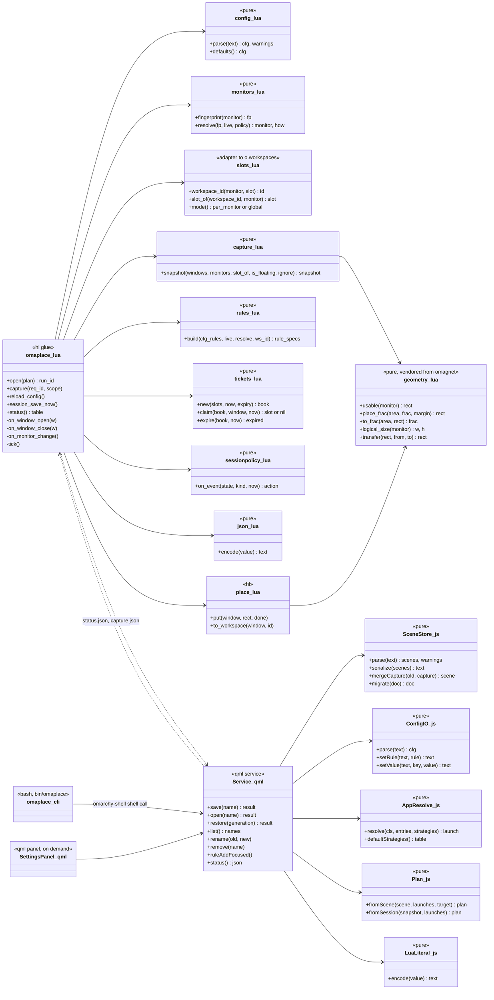
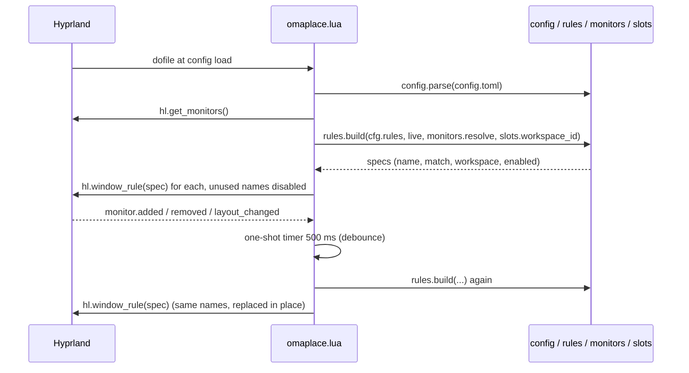
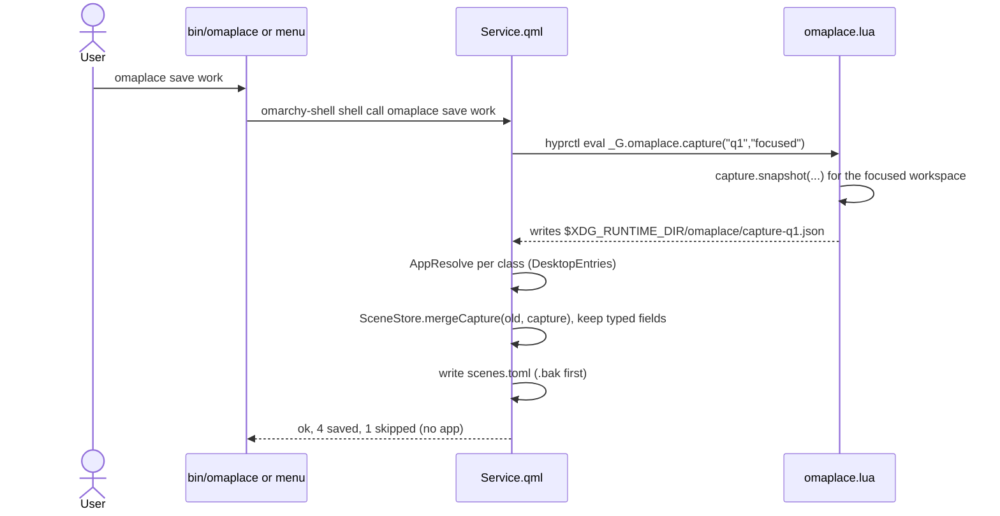
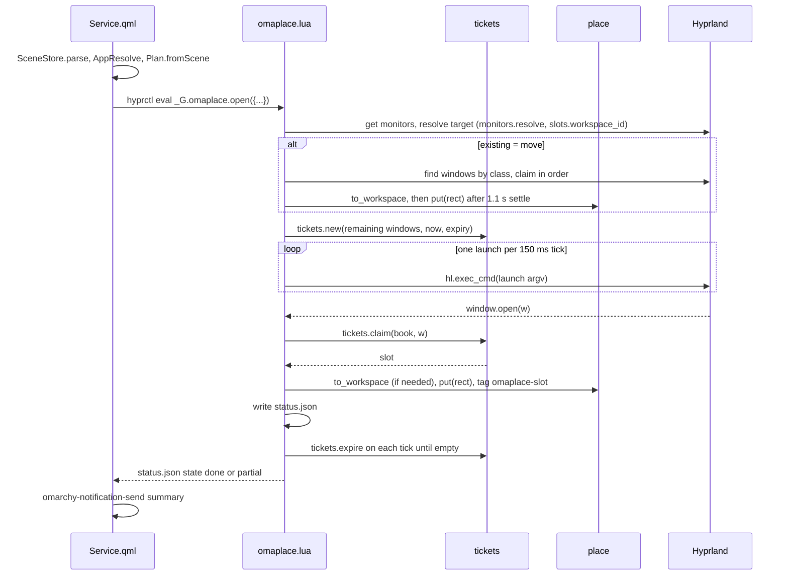
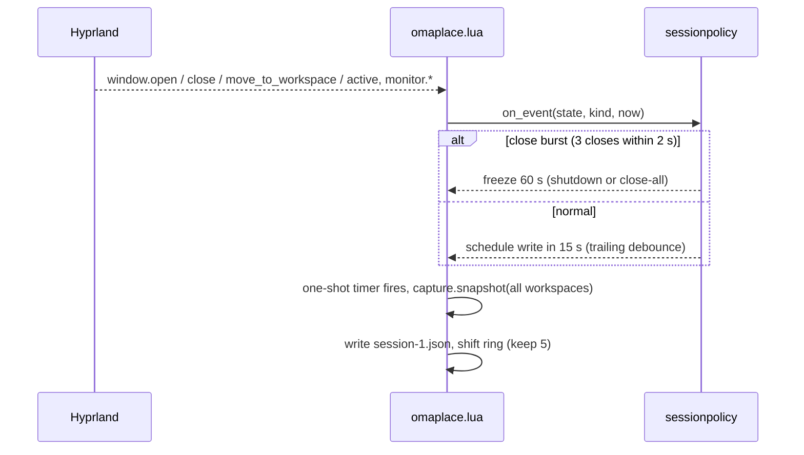

# omaplace design

Status: **draft for review**, 2026-11-21. Source of truth from now on; it supersedes `research.md` and the research files
where they disagree (each place is named in section 12). Target: Omarchy 4.5, Hyprland **0.56.2** (installed). Re-check the
0.57 notes in `research/02` before moving on.

Evidence for every choice is in [research/](research/). Engineering rules are in
[engineering-standards.md](engineering-standards.md); a work package is not done until it meets them.

## 1. What omaplace does

| # | Feature | Milestone |
|---|---|---|
| F1 | **Placement rules.** "App X always opens on slot N of monitor M." Applied every time the app opens. | M1 |
| F2 | **Scenes.** Save the apps on one workspace of one monitor, with exact places and sizes. Open a scene in one step. | M2 |
| F3 | **Session.** omaplace keeps a snapshot of all workspaces by itself. "Restore last session" opens it. | M3 |
| F4 | **Monitor identity.** Rules, scenes and the session find their monitor again after a port change, a dock or an unplug. | M1, used by all |

What it never does: patch Omarchy, edit the user's Hyprland files, run on a timer, store window titles or command lines,
take default keys, or add a bar icon by default.

Gap this fills (checked in source, `research/08`, `research/09`): no project has F1 with a monitor choice, and none
combines exact geometry with a port-proof monitor identity outside tmux windows.

## 2. Principles (from Felipe, binding)

1. **Extend, never replace.** Only documented Omarchy seams (section 3). Nothing under `/usr/share/omarchy`, no edits to
   `~/.config/hypr/*`, no systemd units, no global Hyprland options, no Omarchy state files written.
2. **Code standards per language.** See [engineering-standards.md](engineering-standards.md).
3. **Minimum resources.** Event driven. No polling. No resident process of our own. No extra runtime (no Python, no Node at
   run time, no compiled binary). Idle cost is a few event handlers that return at once.
4. **Isolation of concerns.** Capture, storage, app resolution, monitor resolution, matching, launching, placing and UI are
   separate modules with one job each. Pure logic never calls Hyprland. Each file has one writer.
5. **Flexibility and scale.** Behaviour is a setting with a safe default. Users extend the app strategy table without code.
   Works with 100+ windows and several monitors.
6. **Privacy.** No titles, no `/proc` arguments, no URLs, no folders unless the user typed them.

## 3. Where omaplace plugs into Omarchy

| Seam | How omaplace uses it | Who writes it |
|---|---|---|
| Plugin folder `~/.config/omarchy/plugins/omaplace/` | Installed by `omarchy plugin add`. Holds everything, including the Lua module and the CLI | the installer |
| One line in the user's `hyprland.lua` | `pcall(dofile, os.getenv("HOME") .. "/.config/omarchy/plugins/omaplace/lua/omaplace.lua")`, added by the user from the README, same as omagnet and omahop | the user |
| Hyprland Lua API (`hl.on`, `hl.window_rule`, `hl.dsp`, `hl.get_*`, `hl.exec_cmd`, `hl.timer`) | Events, named rules, placement | omaplace Lua |
| `o.workspaces.workspace_id(monitor, slot)` (`/usr/share/omarchy/default/hypr/monitor-workspaces.lua:298`, exported as `o.workspaces`) | Turn "monitor + slot" into a workspace id. Read through one adapter (`slots.lua`) only | Omarchy |
| `uwsm app -- <desktop-id>` and Omarchy launchers (`omarchy-launch-webapp`, `omarchy-launch-tui`, `xdg-terminal-exec`) | Launch apps the way Omarchy does (`uwsm app` takes a desktop entry id, checked in its help) | Omarchy |
| Shell plugin `service` and `panel` kinds, `omarchy-shell shell call/toggle omaplace ...` | Storage, app resolution, CLI target, settings window | omaplace QML |
| `~/.config/omarchy/extensions/omarchy-menu.jsonc` (read by `shell/plugins/menu/Menu.qml:57`) | One "Scenes" menu, added only when the user presses "Add to menu" in settings, with a backup first | omaplace, with consent |
| `omarchy-notification-send` | Result of an open or restore | omaplace QML |
| `_G.omagnet.fit_shadow` (optional) | After placing, if omagnet is loaded, looked up at use time inside `pcall` | omagnet |

Never touched: `autostart.lua`, `bindings.lua`, `monitors.lua`, `hyprland.lua` (beyond the user's own line),
`~/.local/state/omarchy/**`, `omarchy-system`, the dock, Omarchy's `omarchy-floating-open-*` rules.

## 4. Architecture

Two halves, one contract. The **Lua module** runs inside Hyprland and owns everything that needs the live desktop: events,
rules, capture, monitor and slot resolution, matching, launching and placing. The **shell plugin** (QML plus pure JS) owns
everything that needs files and the desktop entry database: the scene store, settings, app resolution, the CLI target, the
settings window and notifications. Lua cannot list folders or read desktop entries; the shell cannot see `window.open`.
So the split follows the platform, not taste.

```
 user                                                                           Hyprland
  | menu row / CLI bin/omaplace / settings window                                   ^
  v                                                                                 | events, rules, dispatch
 +--------------------- shell plugin (QML + JS, in omarchy-shell) ----+   +--------+------- Lua module (in Hyprland) ------+
 | Service.qml  (IPC target, the only place that talks to Lua)        |   | omaplace.lua (glue: the only file calling hl)  |
 |   SceneStore.js  ConfigIO.js  AppResolve.js  Plan.js  LuaLiteral.js|   |   config  geometry  monitors  slots  capture   |
 | SettingsPanel.qml (loaded on demand)                               |   |   rules  tickets  sessionpolicy  json  place   |
 +--------------------------------------------------------------------+   +------------------------------------------------+
        |  writes scenes.toml, config.toml           hyprctl eval (async Process, argv, no shell)  ^
        |  reads capture.json, status.json  <------- files in $XDG_RUNTIME_DIR/omaplace/  <-------+ writes
        |  reads session/*.json            <------- files in ~/.local/state/omaplace/     <-------+ writes
```

### 4.1 Files and their single writer

| File | Format | Writer | Readers | Holds |
|---|---|---|---|---|
| `~/.config/omaplace/config.toml` | TOML subset (omagnet's) | `ConfigIO.js` | Lua `config.lua`, `ConfigIO.js` | Settings and placement rules |
| `~/.config/omaplace/scenes.toml` | TOML subset, numbered sections | `SceneStore.js` | `SceneStore.js` only | Named scenes |
| `~/.config/omaplace/*.bak` | copy | `SceneStore.js`, `ConfigIO.js` | user | One level of undo |
| `~/.local/state/omaplace/session-<n>.json` (n = 1..5, ring) | JSON | Lua glue | `Service.qml` | Session snapshots |
| `$XDG_RUNTIME_DIR/omaplace/capture-<req>.json` | JSON | Lua glue | `Service.qml` | One capture answer |
| `$XDG_RUNTIME_DIR/omaplace/status.json` | JSON | Lua glue | `Service.qml` | Progress of the current run |

Scenes are TOML (decision D2) because users keep them in dotfiles and edit them; only JS reads them, and JS hands Lua a
ready plan, so Lua never needs a scene parser. Lua writes JSON because it only encodes (a 40-line pure encoder) and JS
reads JSON natively. Config is read by both sides, so it stays in the family TOML subset with a cross-check test, like
omagnet.

### 4.2 Module diagram

Modules, not classes. `<<pure>>` = no Hyprland, no files, unit tested with plain `lua` or Node. `<<hl>>` = touches
Hyprland, tested with a fake `hl`. `<<qml>>` = runs in the shell, checked live or by hand.



### 4.3 Responsibilities, one line each

| Module | Job | Must not |
|---|---|---|
| `lua/omaplace.lua` | Register events, own timers, call `hl`, read and write omaplace files, expose `_G.omaplace` | Hold logic that can be pure |
| `lua/config.lua` | Parse config.toml subset, apply defaults, report bad values | Touch `hl` or files |
| `lua/geometry.lua` | Rect math, fractions of the usable area. Header names the omagnet commit it was copied from | Diverge from omagnet without the parity test failing |
| `lua/monitors.lua` | Fingerprint a monitor, resolve a fingerprint to a live monitor with a named fallback step | Read Omarchy state files |
| `lua/slots.lua` | The only code that knows Omarchy's workspace model | Be called with a global id as if it were a slot |
| `lua/capture.lua` | Turn live windows and monitors into a snapshot (class, rect fraction, slot, flags) | Store titles, pids, addresses |
| `lua/rules.lua` | Turn config rules plus live monitors into named rule specs (enabled or disabled) | Call `hl.window_rule` itself |
| `lua/tickets.lua` | Match new windows to waiting slots by class, in order, with expiry | Use title, pid or address as identity |
| `lua/sessionpolicy.lua` | Decide when to write a session snapshot (debounce, close-burst freeze) | Read the clock or write files |
| `lua/json.lua` | Encode tables to JSON | Decode (not needed) |
| `lua/place.lua` | Resize, then move, check the size, retry at most twice; leave fullscreen first; settle after a workspace move | Decide where a window goes |
| `Service.qml` | IPC methods, run `hyprctl eval` as an async `Process` with argv, watch status and capture files, notifications | Parse or build data by hand (calls the JS modules) |
| `js/SceneStore.js` | Read, write, migrate scenes.toml; merge a re-capture without losing typed fields | Know about Hyprland |
| `js/ConfigIO.js` | Read and edit config.toml line by line, keep unknown keys | Rewrite the whole file |
| `js/AppResolve.js` | Class plus desktop entry list plus strategy table to a launch recipe | Read `/proc` |
| `js/Plan.js` | Scene or snapshot plus launch recipes to the plan Lua runs | Know file paths |
| `js/LuaLiteral.js` | Safe Lua table literal (escapes every string) | Emit code other than one table |
| `bin/omaplace` | Map CLI words to IPC calls, print results, set exit codes | Hold logic |
| `SettingsPanel.qml` + pages | Scenes, Rules, Session, General pages; the "Add to menu" consent | Write files except through `Service.qml` |

## 5. Data model

All examples are made up.

### 5.1 Monitor fingerprint (F4)

```
{ identity = "Example Corp EX27 #1", make = "Example Corp", model = "EX27", serial_hash = "a1b2c3",
  internal = false, width = 2560, height = 1440, scale = 1.25, transform = 0, last_connector = "DP-2" }
```

`identity` is Omarchy's own key (description, `#N` for twins). `serial_hash` is a short hash, never the serial.

`monitors.resolve(fp, live, policy)` tries, in order, and returns which step matched:

1. `identity` equal.
2. make, model and serial_hash equal.
3. make and model equal, only one such monitor live.
4. `internal` equal and true (laptop panel).
5. Same shape class (aspect within 2 percent, size within 10 percent).
6. Policy `missing_monitor`: `focused` (default for scenes) or `skip` (default for rules).

### 5.2 Rule (config.toml)

```toml
[rule.editor]
app = "org.example.Editor"      # matched against initialClass
monitor = "Example Corp EX27 #1" # identity; empty = any monitor, keep the slot
slot = 3                        # 1..10 inside that monitor's block
follow = false                  # true: switch to the workspace when it opens
enabled = true
```

Rules place on a workspace only. Exact size and place on open is a later option (`keep_rect`), done by dispatch after open,
never by a rule `move`/`size` effect, so Omarchy's own open rules can never fight it (they are rebuilt at runtime,
`workspace-modes.lua:279,387,409`, so rule order is not stable).

### 5.3 Scene (scenes.toml)

```toml
schema = 1

[scene.work]
existing = "move"            # move | new
home_monitor = ""            # empty: open on the current monitor; else an identity
home_slot = 0                # 0: current workspace; else 1..10
key = ""                     # optional, user picked
saved_on = "Example Corp EX27 #1"

[scene.work.window.1]
app = "org.example.Editor"   # desktop entry id, from AppResolve at capture
class = "org.example.Editor" # initialClass, the match key
rect = "0 0 0.5 1"           # x y w h fractions of the usable area
floating = true
launch = ""                  # typed by the user only
folder = ""                  # typed by the user only
```

### 5.4 Plan (JS to Lua, as one Lua table literal)

```lua
{ run = "r-20261121-1", target = { fp = {...}, slot = 0 }, existing = "move", expiry_s = 20,
  windows = {
    { class = "org.example.Editor", rect = {0, 0, 0.5, 1}, floating = true,
      launch = { "uwsm", "app", "--", "org.example.Editor.desktop" }, mode = "launch" },
    { class = "chromium", rect = {0.5, 0, 0.5, 1}, floating = true, mode = "place_only" },
  } }
```

`mode`: `launch` (start it if no window to move), `place_only` (never start; apps that restore themselves),
`skip` (unresolved app, reported).

### 5.5 Snapshot (Lua to JS, capture and session)

```json
{ "schema": 1, "kind": "session", "saved_at": 1763700000, "mode": "per_monitor",
  "monitors": [ { "fp": { "identity": "Example Corp EX27 #1", "internal": false } } ],
  "windows": [ { "class": "org.example.Editor", "monitor": 0, "slot": 2, "rect": [0, 0, 0.5, 1],
                 "floating": true, "fullscreen": 0, "minimized": false } ] }
```

### 5.6 Status (Lua to JS)

```json
{ "run": "r-20261121-1", "state": "running", "items": [
  { "class": "org.example.Editor", "state": "placed" },
  { "class": "org.example.Mail", "state": "waiting", "since": 1763700001 } ] }
```

Item states: `waiting`, `placed`, `moved`, `skipped`, `not_reopened` (ticket expired), `failed` (with a reason code).
Run states: `running`, `done`, `partial`, `interrupted` (Lua reloaded mid-run).

### 5.7 App strategy table (AppResolve, user extendable)

| Strategy | When | Launch |
|---|---|---|
| `desktop` (default) | Class maps to a desktop entry (omahop's lookup chain: id, StartupWMClass, lower case, last part of a reverse DNS id) | `uwsm app -- <id>.desktop` |
| `webapp` | Class `chrome-*-Default` and a matching web app desktop entry | the entry's own Exec through `uwsm app` |
| `terminal` | A terminal class; `folder` typed | `uwsm app -- xdg-terminal-exec --dir=<folder>` |
| `tui` | Class `org.omarchy.<cmd>` | `omarchy-launch-tui <cmd>` |
| `place_only` | Browsers and Electron apps that restore their own windows (default list: chromium, google-chrome, firefox, code, obsidian, slack, spotify) | none |
| `command` | User typed `launch` | the typed argv through `uwsm app --` |

Users add `[strategy.<name>]` sections in config.toml (`match = "class pattern"`, `use = "<strategy>"`). Unknown classes with
no entry are `skip` and listed in the result, never guessed.

## 6. Interactions

### 6.1 Rules at load and on monitor change (F1, F4)



### 6.2 Save a scene (F2)



### 6.3 Open a scene (F2)



### 6.4 Session snapshot (F3)



Staleness limit (stated, not hidden): Hyprland has no move or resize event, so a window dragged and then left alone is saved
with its old rect until any later event (focus change, open, close). In normal use focus changes come within seconds.
`omaplace session save` saves at once.

### 6.5 Restore the session (F3)

Same as 6.3, with `Plan.fromSession`: each window goes to its own saved monitor and slot (not the current one), resolved
through `monitors.resolve` with policy `focused`. Restore at login is a later setting (`restore_at_login`), off in v1.

## 7. Interfaces (contracts the builders code against)

### 7.1 Lua API on `_G.omaplace`

| Call | Returns | Notes |
|---|---|---|
| `open(plan)` | run id string, or `nil, err` | Starts a run; one run at a time, a second call answers `busy` |
| `capture(req_id, scope)` | `true` | `scope`: `focused` or `all`; writes `capture-<req_id>.json` |
| `reload_config()` | `true` or `nil, err` | Re-reads config.toml, rebuilds rules |
| `session_save_now()` | `true` | Ignores the debounce, not the freeze |
| `status()` | table | Same as status.json |
| `version` | string | For the service to check compatibility |

### 7.2 Service IPC (`omarchy-shell shell call omaplace <method> ...`)

`save NAME`, `open NAME`, `restore [GEN]`, `list`, `rename OLD NEW`, `remove NAME`, `rule-add-focused`, `rule-remove NAME`,
`status`, `settings` (opens the panel). Each returns one line of JSON: `{ "ok": true|false, "code": "...", ... }`.

### 7.3 CLI `bin/omaplace`

Same words as 7.2. Exit codes: 0 ok, 2 bad usage, 3 not found, 4 partial (some windows not placed), 5 failed,
6 Lua module not loaded (`_G.omaplace` missing: prints the README line to add). Plain text output by default, `--json` passes
the IPC line through. The CLI lives in the plugin folder; the menu row calls it by full path. Users may alias it.

### 7.4 Window tag

Placed windows get `omaplace-slot=<run>/<n>`. It stops a window being claimed twice and lets omagnet or omahop step aside later.

### 7.5 Settings (config.toml, top level)

| Key | Default | Unconfirmed? |
|---|---|---|
| `schema` | 1 | |
| `missing_monitor_scene` | `focused` | yes |
| `missing_monitor_rule` | `skip` | yes |
| `existing_default` | `move` | yes |
| `expiry_seconds` | 20 | |
| `settle_ms` | 1100 | |
| `launch_tick_ms` | 150 | |
| `session` | `on` | yes (session in v1 at all) |
| `session_debounce_s` | 15 | |
| `session_keep` | 5 | |
| `restore_at_login` | `off` | yes |
| `exact_on_tiled` | `false` (place workspace only on tiled workspaces) | yes |
| `ignore` | `""` | |

## 8. Performance budget

| Item | Budget |
|---|---|
| Idle | No timers armed, no process started. Event handlers return in under 0.1 ms when nothing is waiting |
| Rule rebuild | Only on config reload and monitor change, debounced 500 ms |
| Session write | At most one per 15 s, only after events, under 5 ms for 100 windows |
| Open a scene | One launch per 150 ms; no `hyprctl` from Lua; no sync process anywhere |
| Shell | The service is small and resident (the shell already runs); the settings panel loads on demand |
| Memory | No new process. No Quickshell overlay |

Any work package that adds per-event work records a measurement in `docs/batch-log.md`.

## 9. Decisions

| # | Decision | Status |
|---|---|---|
| D1 | Separate private plugin, not inside omagnet; copy four geometry functions with a parity test (`research/07`) | decided |
| D2 | Scenes and config in the family TOML subset; Lua output in JSON; plan passed as a Lua literal | decided |
| D3 | Match new windows by `initialClass` and ticket order only; never title, pid or address (`research/02`, `04`) | decided |
| D4 | Exec rules are not used (lost through `uwsm app`); spawn then claim | decided |
| D5 | Slot to workspace id only through `o.workspaces.workspace_id`, behind `slots.lua` | decided |
| D6 | Rules set the workspace only; rects are dispatched after open | decided |
| D7 | Saves are event driven with a debounce and a close-burst freeze; no periodic timer (supersedes `autosave_minutes` in 06) | decided |
| D8 | Rules rebuild on monitor events; scenes and sessions resolve monitors only when opened | decided |
| D9 | Scene opens on the current workspace and monitor by default; home is opt-in | default, unconfirmed |
| D10 | Already-open apps are moved, missing ones launched (`existing = move`) | default, unconfirmed |
| D11 | One `scenes.toml` for all scenes | default, unconfirmed |
| D12 | Terminal folders and launch lines are typed by the user only | default, unconfirmed |
| D13 | Workspace placement everywhere; exact rects on floating workspaces only | default, unconfirmed |
| D14 | Soft link to omagnet (`fit_shadow`, slot tag) | default, unconfirmed |
| D15 | Session snapshot and manual restore in this plan as M3; restore at login off | default, unconfirmed |
| D16 | Private now; code written public-safe (scrub test from day one) | default, unconfirmed |

## 10. Spikes (live checks, each needs Felipe's OK, one harmless window, no input events)

| # | Question | How to check | Gates |
|---|---|---|---|
| S1 | Is `hyprctl eval` happy with a 10 kB Lua literal argument? | eval a large table that only returns its length | WP5 |
| S2 | Does `window.open` arrive for an app started by `uwsm app -- <id>.desktop`, and how long after? | launch one small app, log class and delay only | WP4 |
| S3 | Does a single-instance app that only raises an old window send `window.open`? | open a second copy of one such app | WP4 (expected: no, ticket expires) |
| S4 | Does our dispatch after Omarchy's open rule land the exact rect on a floating workspace? | place one test window | WP4 |
| S5 | What does `omarchy-shell shell call` print and return for a third-party service? | call a no-op method | WP5 |
| S6 | Does a menu `action` row with a full path to our CLI run from the Omarchy menu? | add a row in a copy, then restore | WP8 |
| S7 | Two monitors: rule to slot of the second monitor, unplug, replug | needs a real second monitor, never a virtual one | WP2 sign-off |

## 11. Work packages (for builder sub-agents)

Every package: read this file and `engineering-standards.md` first; own only the files listed; no file is owned by two
packages; tests listed are part of done. Fake `hl` and fake `o.workspaces` live in `lua/tests/fake_hl.lua` (owned by WP1).

| WP | Scope | Owns | Tests | Depends on |
|---|---|---|---|---|
| WP0 | Repo scaffold: `manifest.json`, folder layout, `tests/run-all.sh`, `tests/scrub.sh`, `docs/batch-log.md`, `docs/validation-checklist.md`, README install and removal | those files | run-all prints each suite; scrub passes | none |
| WP1 | Lua pure core: `config.lua`, `geometry.lua` (vendored), `monitors.lua`, `slots.lua`, `json.lua`, `lua/tests/fake_hl.lua` | those + their `lua/tests/test_*.lua` | unit tests; geometry parity test against `../omagnet/lua/geometry.lua` (skipped with a visible SKIP if omagnet is absent) | WP0 |
| WP2 | F1 rules: `rules.lua` and the rule part of `omaplace.lua` (load, reload, monitor debounce) | `lua/rules.lua`, `lua/omaplace.lua` (created here) | unit tests for `rules.build`; fake-`hl` test: rules created, renamed in place, disabled when the monitor is gone | WP1 |
| WP3 | JS pure: `js/ConfigIO.js`, `js/SceneStore.js`, `js/AppResolve.js`, `js/Plan.js`, `js/LuaLiteral.js` | those + `tests/*.test.mjs` | Node tests; ConfigIO cross-check against Lua `config.lua` on shared fixtures in `tests/fixtures/` | WP0 (parallel with WP1) |
| WP4 | F2 engine in Lua: `capture.lua`, `tickets.lua`, `place.lua`, and `open`, `capture`, status writing in `omaplace.lua` | `lua/capture.lua`, `lua/tickets.lua`, `lua/place.lua`; edits `lua/omaplace.lua` after WP2 is merged | unit tests; fake-`hl` run: move mode, launch mode, expiry, busy, interrupted | WP1, WP2 merged |
| WP5 | Service and CLI: `Service.qml`, `bin/omaplace`, notifications | those | shellcheck; a fake service script for CLI exit codes; live check after S1 and S5 | WP3, WP4 |
| WP6 | Settings window: `SettingsPanel.qml`, `pages/*.qml`, `SceneRow.qml`, launcher `.desktop` | those | qmllint; hand check in the validation checklist | WP5 |
| WP7 | F3 session: `sessionpolicy.lua`, the session part of `omaplace.lua`, `Plan.fromSession` wiring in `Service.qml` | `lua/sessionpolicy.lua`; edits after WP4 and WP5 are merged | unit tests for burst and debounce; fake-`hl` ring rotation | WP4, WP5 |
| WP8 | Menu integration with consent and backup; final docs | the menu writer in `js/MenuExt.js` and its test, README sections | Node test on a fixture jsonc; S6 | WP5 |

Order: WP0, then WP1 and WP3 in parallel, then WP2, then WP4, then WP5, then WP6, WP7 and WP8 in parallel. `omaplace.lua`
is edited by WP2, WP4 and WP7 in that order, never at the same time.

Milestones: **M1** = WP0, WP1, WP2 (rules work from config.toml). **M2** = WP3 to WP6 (scenes). **M3** = WP7 (session).
**M4** = WP8 and release work.

## 12. Where this supersedes research

- `research/06` periodic `autosave_minutes` and "save on logout": replaced by D7 (no timer, no exit hook exists).
- `research/06` sample used `home_workspace` names: replaced by `home_monitor` + `home_slot` (D5, F4).
- `research/04` summary line "class plus a launch token": replaced by D3 (the token is lost through `uwsm app`).
- `research/05` "never react to dropouts live" vs "re-resolve on every add": rules rebuild on events, scenes resolve at open (D8).
- `research/07` suggested JSON scenes: replaced by D2 (JS-only reader, user-editable TOML).

## 13. Risks

| Risk | Answer |
|---|---|
| Hyprland Lua API changes (young API, 0.57 renames) | Small glue, fake-`hl` tests catch it; `version` check in the service |
| Omarchy changes `o.workspaces` | One adapter (`slots.lua`) with a fallback to global numbering, and a test that fails loudly |
| Wrong window in a slot when two apps share a class | Accepted and documented: order decides, not content |
| Apps that never send a new window | Ticket expires, reported as `not_reopened` |
| Core PR #18858 lands with scenes | Our F1 and F4 still stand; revisit F2 overlap then |
